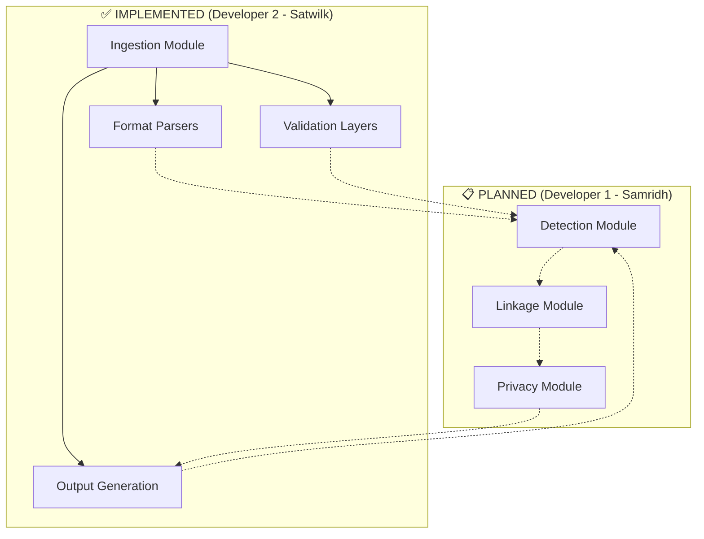
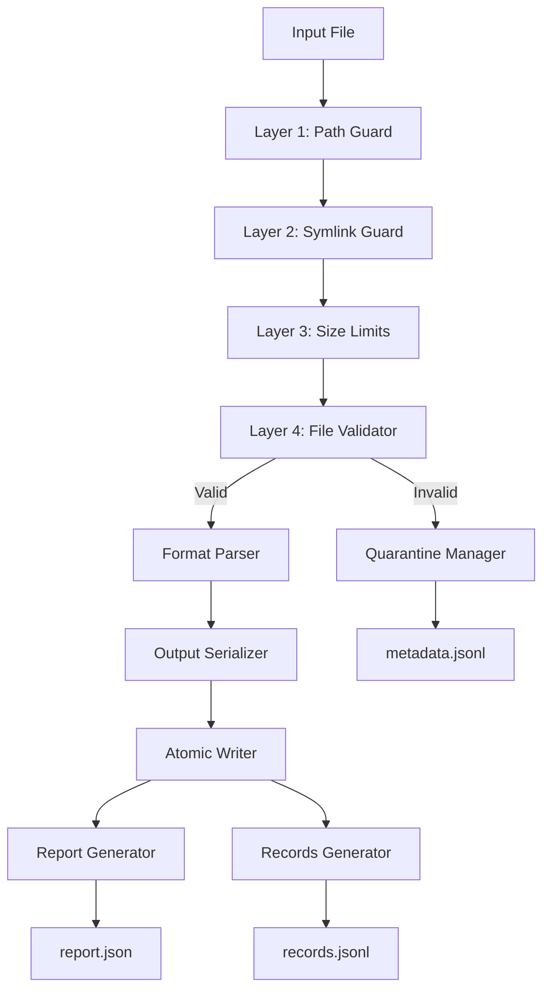

# LOCKMATE Hackathon Study Guide — Document 1
## Project Overview & Architecture

---

### 1.1 Project Summary

| Attribute | Value |
|-----------|-------|
| **Project Name** | LOCKMATE |
| **Version** | 0.1.0 (Pre-Alpha) |
| **Description** | Secure data ingestion and processing pipeline for healthcare data |
| **License** | MIT |
| **Python Requirement** | ≥ 3.11 |
| **Authors** | Samridh (Detection/Linkage/Privacy), Satwilk (Ingestion/Output) |

**Status**: Only the **Ingestion module (Developer 2 - Satwilk)** is **IMPLEMENTED**. The Detection, Linkage, and Privacy modules (Developer 1 - Samridh) are **PLANNED** per architecture docs but not yet present in the repository.

---

### 1.2 High-Level Architecture



---

### 1.3 Repository Structure (Actual)

```
lockmate/
├── src/
│   └── lockmate/
│       ├── __init__.py                    # Exports SecureIngestionPipeline
│       └── ingestion/
│           ├── __init__.py                # Exports SecureIngestionPipeline, IngestionConfig, IngestionResult
│           ├── secure_ingest.py           # Main pipeline orchestration (222 lines)
│           ├── parsers/
│           │   ├── __init__.py
│           │   ├── csv_parser.py          # CSV/TSV parsing (144 lines)
│           │   ├── json_parser.py         # JSON/Nested JSON parsing (191 lines)
│           │   ├── text_parser.py         # Plain-text parsing (161 lines)
│           │   └── fhir_parser.py         # FHIR R4 parsing (207 lines)
│           ├── validation/
│           │   ├── __init__.py
│           │   ├── file_validator.py      # MIME/encoding validation (211 lines)
│           │   ├── path_guard.py          # Path traversal protection (99 lines)
│           │   ├── symlink_guard.py       # Symlink security (99 lines)
│           │   ├── size_limits.py         # File size/resource limits (104 lines)
│           │   └── quarantine.py          # Malformed file quarantine (214 lines)
│           ├── output/
│           │   ├── __init__.py
│           │   ├── serializer.py          # Sanitized serialization (160 lines)
│           │   ├── atomic_write.py        # Atomic writes (230 lines)
│           │   ├── report_generator.py    # report.json generation (241 lines)
│           │   └── records_generator.py   # records.jsonl generation (270 lines)
│           └── tests/
│               ├── test_*.py              # 13 test files, 104 tests (97 pass, 7 skipped)
├── docs/
│   ├── ARCHITECTURE.md
│   ├── INTERFACES.md
│   ├── SECURITY.md
│   └── hackathon-study-guide/
├── pyproject.toml
├── pytest.ini
└── README.md
```

---

### 1.4 Developer Responsibilities

| Developer | Modules | Status |
|-----------|---------|--------|
| **Samridh** (Dev 1) | Detection, Linkage, Privacy | 📋 PLANNED — Not in repo |
| **Satwilk** (Dev 2) | Ingestion, Parsers, Validation, Output | ✅ IMPLEMENTED — 100% complete |

---

### 1.5 Data Flow Pipeline



---

### 1.6 Key Design Principles

1. **Security-First**: 5-layer defense-in-depth before any parsing
2. **Atomic Operations**: No partial writes — all outputs use `os.replace`
3. **Structured Logging**: `structlog` for observability
4. **Type Safety**: Pydantic v2 for all config and data models
5. **Synthetic Data Only**: No real PHI in tests or fixtures
6. **Modularity**: Each validator/parser is independently testable

---

### 1.7 Technology Stack

| Category | Dependencies |
|----------|--------------|
| **Core** | pydantic≥2.5, pydantic-settings≥2.1 |
| **Parsing** | pandas≥2.1, fhir.resources≥7.0, orjson≥3.9 |
| **Security** | python-magic≥0.4.27, charset-normalizer≥3.3, xxhash≥3.4 |
| **Logging** | structlog≥24.1 |
| **Resilience** | tenacity≥8.2 |
| **Testing** | pytest, hypothesis (planned) |

---

### 1.8 Quick Start

```bash
# Install in development mode
pip install -e ".[dev]"

# Run all tests (97 pass, 7 skipped - symlink tests on Windows)
pytest -v

# Run ingestion pipeline programmatically
python -c "
from lockmate.ingestion import SecureIngestionPipeline, IngestionConfig
from pathlib import Path

config = IngestionConfig(
    input_dir=Path('./data'),
    output_dir=Path('./output'),
    quarantine_dir=Path('./quarantine'),
    allowed_roots=[Path('./data')]
)
pipeline = SecureIngestionPipeline(config)
result = pipeline.run()
print(f'Processed: {len(result.processed_files)} files, {result.total_records} records')
"
```

---

### 1.9 Document Navigation

| Doc | Title | Focus |
|-----|-------|-------|
| 01 | Project Overview & Architecture | This document |
| 02 | Ingestion Pipeline Deep Dive | `secure_ingest.py` orchestration |
| 03 | Security Architecture | 5-layer defense model |
| 04 | Format Parsers | CSV, JSON, Text, FHIR |
| 05 | Validation Modules | Path, Symlink, Size, Validator, Quarantine |
| 06 | Output Generation | Serializer, Atomic Write, Report, Records |
| 07 | Configuration & Models | Pydantic configs, IngestionConfig |
| 08 | Integration Testing | Test results, coverage, fixtures |
| 09 | Error Handling & Logging | Exception hierarchy, structlog |
| 10 | Shared Interfaces | Ingestion → Detection/Linkage/Privacy |
| 11 | Demo Preparation | Live demo script, talking points |
| 12 | Judge Q&A Preparation | Anticipated questions & answers |
| 13 | Performance & Limits | Benchmarks, resource constraints |
| 14 | Deployment & Operations | Production considerations |
| 15 | Future Work | Detection, Linkage, Privacy roadmap |

---

### 1.10 Key Files to Know

| File | Lines | Purpose |
|------|-------|---------|
| `src/lockmate/ingestion/secure_ingest.py` | 222 | Main pipeline entry point |
| `src/lockmate/ingestion/parsers/*.py` | ~700 | 4 format parsers |
| `src/lockmate/ingestion/validation/*.py` | ~727 | 5 security validators |
| `src/lockmate/ingestion/output/*.py` | ~901 | 4 output modules |
| `src/lockmate/ingestion/tests/test_integration.py` | 353 | Full pipeline integration tests |
| `docs/ARCHITECTURE.md` | 215 | Architecture decision record |
| `docs/INTERFACES.md` | 167 | Module contracts |
| `docs/SECURITY.md` | 70 | Security policy |

---

> **⚠️ IMPORTANT**: When presenting at the hackathon, **clearly distinguish** between:
> - ✅ **IMPLEMENTED**: Ingestion, Parsers, Validation, Output (all tested, 97/104 tests pass)
> - 📋 **PLANNED**: Detection, Linkage, Privacy (defined in INTERFACES.md, not coded)
> - ❌ **NOT IMPLEMENTED**: Any features not in the above lists