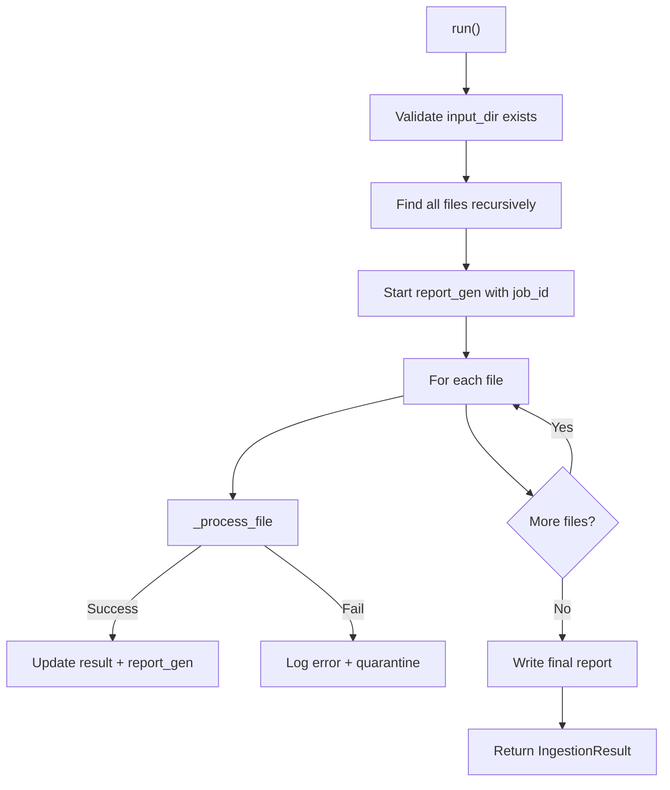

# LOCKMATE Hackathon Study Guide — Document 2
## Ingestion Pipeline Deep Dive

---

### 2.1 Pipeline Entry Point: `SecureIngestionPipeline`

**File**: `src/lockmate/ingestion/secure_ingest.py` (222 lines)

```python
class SecureIngestionPipeline:
    """Secure file ingestion and processing pipeline."""
    
    def __init__(self, config: IngestionConfig) -> None:
        self.config = config
        # Initialize all 5 security layers
        self.path_guard = PathGuard(allowed_roots=config.allowed_roots or [config.input_dir])
        self.symlink_guard = SymlinkGuard(enabled=not config.follow_symlinks)
        self.size_limiter = SizeLimiter(max_file_size=config.max_file_size)
        self.validator = FileValidator(config=config.validation)
        self.quarantine = QuarantineManager(config=quarantine_config)
        
        # Initialize output generators
        self.report_gen = ReportGenerator(config=report_config)
        self.records_gen = RecordsGenerator(config=records_config)
```

---

### 2.2 Two Processing Modes

| Method | Use Case | Returns |
|--------|----------|---------|
| `run()` | Batch process entire input directory | `IngestionResult` |
| `ingest_file(file_path)` | Process single file (iterator) | `Iterator[dict]` |

---

### 2.3 `run()` Method Flow



---

### 2.4 `_process_file()` Detailed Flow

```python
def _process_file(self, file_path: Path, result: IngestionResult) -> None:
    try:
        # LAYER 1: Path Security
        safe_path = self.path_guard.validate(file_path)
        
        # LAYER 2: Symlink Security
        self.symlink_guard.check(safe_path)
        
        # LAYER 3: Size Limits
        self.size_limiter.check(safe_path)
        
        # LAYER 4: File Validation
        validation_result = self.validator.validate(safe_path)
        if not validation_result.is_valid:
            self.quarantine.quarantine(safe_path, reason=validation_result.reason)
            result.quarantined_files.append(str(file_path))
            self.report_gen.add_file_quarantined(file_path)
            return
        
        # LAYER 5: Parsing
        parser = self._get_parser(validation_result.mime_type)
        records = list(parser.parse(safe_path, encoding=validation_result.encoding))
        
        # Output Generation
        if records:
            self.records_gen.write_records(iter(records), filename=f"{file_path.stem}.jsonl")
        
        # Update Statistics
        result.total_records += len(records)
        result.processed_files.append(str(file_path))
        self.report_gen.add_file_processed(...)
        
    except Exception as e:
        # Quarantine on any exception
        self.quarantine.quarantine(file_path, reason=f"Exception: {str(e)}")
        result.failed_files.append(str(file_path))
        result.errors.append({"file": str(file_path), "error": str(e)})
        raise
```

---

### 2.5 Parser Selection Logic

```python
def _get_parser(self, mime_type: str) -> Any:
    """Get the appropriate parser for the given MIME type."""
    if "csv" in mime_type or "tab-separated" in mime_type:
        return CSVParser()
    elif "json" in mime_type:
        return JSONParser()
    elif "fhir" in mime_type:
        return FHIRParser()
    else:
        return TextParser()  # Default fallback
```

**MIME Type Mapping** (from `file_validator.py`):
| Extension | MIME Type | Parser |
|-----------|-----------|--------|
| `.csv` | `text/csv` | CSVParser |
| `.tsv` | `text/tab-separated-values` | TSVParser (CSVParser subclass) |
| `.json` | `application/json` | JSONParser |
| `.ndjson`, `.jsonl` | `application/x-ndjson` | JSONParser |
| `.fhir.json` | `application/fhir+json` | FHIRParser |
| `.txt` | `text/plain` | TextParser |
| *others* | *detected* | TextParser (fallback) |

---

### 2.6 IngestionConfig — Full Configuration

```python
class IngestionConfig(BaseModel):
    model_config = ConfigDict(arbitrary_types_allowed=True)
    
    # Required paths
    input_dir: Path
    output_dir: Path
    quarantine_dir: Path
    allowed_roots: list[Path] = []
    
    # Resource limits
    max_file_size: int = 100 * 1024 * 1024      # 100MB
    max_total_size: int = 1024 * 1024 * 1024    # 1GB
    follow_symlinks: bool = False
    
    # Validation settings
    validation: ValidationConfig = Field(default_factory=ValidationConfig)
```

---

### 2.7 IngestionResult — Return Value

```python
class IngestionResult(BaseModel):
    job_id: UUID = Field(default_factory=uuid4)
    started_at: datetime = Field(default_factory=datetime.utcnow)
    finished_at: datetime | None = None
    success: bool = False
    total_records: int = 0
    processed_files: list[str] = []
    failed_files: list[str] = []
    quarantined_files: list[str] = []
    errors: list[dict[str, Any]] = []
```

---

### 2.8 Integration Test Coverage (from `test_integration.py`)

| Test | Scenario | Assertions |
|------|----------|------------|
| `test_basic_csv_ingestion` | Single CSV file | 3 records, 1 output file |
| `test_json_ingestion` | JSON array | 2 records |
| `test_text_ingestion` | Plain text lines | 3 records (1 per line) |
| `test_multiple_files_ingestion` | 3 files (CSV, JSON, TXT) | 6 total records, 3 outputs |
| `test_quarantine_invalid_file` | Valid + binary file | 1 processed, 1 quarantined |
| `test_path_traversal_blocked` | Symlink outside root | Quarantined/failed (Linux only) |
| `test_size_limit_enforced` | File > 1KB limit | Quarantined, success=False |
| `test_fhir_ingestion` | FHIR Patient resource | ≥1 record |
| `test_report_generation` | Report.json exists | Correct job_id, stats |
| `test_empty_directory` | No files | success=True, 0 records |
| `test_subdirectory_files` | Files in subdirs | 2 files processed |
| `test_ingest_file_method` | Direct method call | 2 records returned |
| `test_tsv_ingestion` | TSV file | 2 records |

---

### 2.9 Key Implementation Details

| Aspect | Implementation |
|--------|----------------|
| **File Discovery** | `input_dir.rglob("*")` filtered to `is_file()` |
| **Error Handling** | Try/except per file, quarantine on any exception |
| **Reporting** | Real-time stats update via `ReportGenerator` |
| **Output Naming** | `{stem}.jsonl` per input file; sharded if `max_records_per_file` set |
| **Atomicity** | All writes via `AtomicWriter` (temp file + `os.replace`) |
| **Logging** | `structlog` with structured fields: `path`, `records`, `mime_type` |

---

### 2.10 Common Gotchas

| Issue | Cause | Fix |
|-------|-------|-----|
| `ValueError: Input directory does not exist` | `input_dir` missing | Ensure directory exists before `run()` |
| `PathTraversalError` | File outside `allowed_roots` | Add parent dir to `allowed_roots` |
| `SizeLimitExceeded` | File > `max_file_size` | Increase limit or split file |
| Quarantined valid files | MIME detection failure | Check `python-magic` install; extension fallback used on Windows |
| Symlink tests skipped | Windows symlink restrictions | Tests skipped on `sys.platform == "win32"` |

---

### 2.11 Extending the Pipeline

To add a new parser:
1. Create `new_parser.py` in `parsers/`
2. Add export to `parsers/__init__.py`
3. Add MIME type mapping in `file_validator.py:_EXTENSION_MIME_TYPES`
4. Add case in `SecureIngestionPipeline._get_parser()`
5. Write tests in `tests/test_new_parser.py`