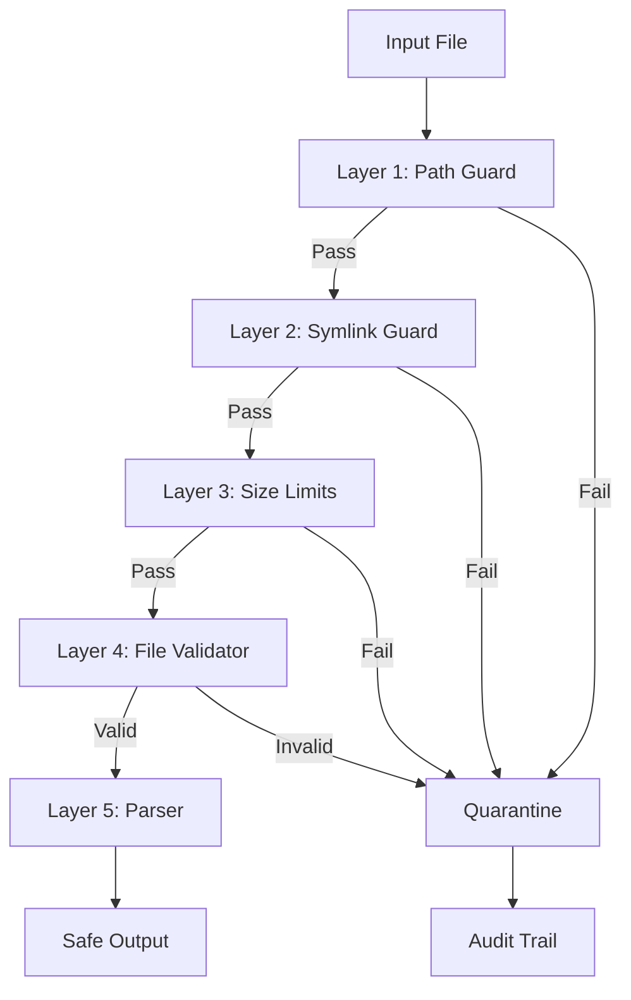

# LOCKMATE Hackathon Study Guide — Document 3
## Security Architecture — 5-Layer Defense Model

---

### 3.1 Security Philosophy

> **Defense in Depth**: Every file passes through 5 sequential validation layers before parsing. Any layer can reject/quarantine the file. No single point of failure.



---

### 3.2 Layer 1: Path Guard (`path_guard.py`)

**Purpose**: Prevent path traversal attacks (`../`, `..\`, absolute paths outside sandbox)

```python
class PathGuard:
    def __init__(self, allowed_roots: list[Path]) -> None:
        self.allowed_roots = [root.resolve() for root in allowed_roots]
    
    def validate(self, path: Union[str, Path]) -> Path:
        path = Path(path).resolve()
        
        # Check 1: Null byte injection
        if "\x00" in str(path):
            raise PathTraversalError(path, "Null byte in path")
        
        # Check 2: Path traversal sequences
        parts = path.parts
        if any(part == ".." for part in parts):
            raise PathTraversalError(path, "Path traversal sequence detected")
        
        # Check 3: Within allowed roots
        if not any(path.is_relative_to(root) for root in self.allowed_roots):
            raise PathTraversalError(path, "Path outside allowed roots")
        
        return path
```

**Test Coverage** (`test_path_guard.py`):
- ✅ Valid path within root
- ✅ Path traversal with `..`
- ✅ Absolute path outside root
- ✅ Null byte in path
- ⏭️ Symlink resolution (skipped on Windows)
- ⏭️ Symlink outside root (skipped on Windows)
- ✅ Multiple allowed roots

---

### 3.3 Layer 2: Symlink Guard (`symlink_guard.py`)

**Purpose**: Prevent directory traversal via symbolic links

```python
class SymlinkGuard:
    def __init__(
        self,
        enabled: bool = True,
        allowed_roots: Optional[list[Path]] = None,
        follow_allowed: bool = False
    ) -> None:
        self.enabled = enabled
        self.allowed_roots = [r.resolve() for r in allowed_roots] if allowed_roots else []
        self.follow_allowed = follow_allowed
    
    def check(self, path: Union[str, Path]) -> None:
        path = Path(path)
        
        if not self.enabled:
            return
        
        # Check if path is a symlink
        if path.is_symlink():
            if not self.follow_allowed:
                raise SymlinkError(path, "Symlinks not allowed (follow_allowed=False)")
            
            # If following allowed, validate target
            target = path.resolve()
            if not any(target.is_relative_to(root) for root in self.allowed_roots):
                raise SymlinkError(path, f"Symlink target outside allowed roots: {target}")
```

**Configuration Modes**:
| Mode | `enabled` | `follow_allowed` | Behavior |
|------|-----------|------------------|----------|
| **Default (Secure)** | `True` | `False` | Block all symlinks |
| **Follow Within Root** | `True` | `True` | Follow only if target in allowed_roots |
| **Disabled** | `False` | *ignored* | No symlink checks |

**Test Coverage** (`test_symlink_guard.py`):
- ✅ No symlink allowed (default)
- ⏭️ Symlink blocked by default (skipped Windows)
- ⏭️ Follow allowed within root (skipped Windows)
- ⏭️ Follow blocked outside root (skipped Windows)
- ⏭️ Parent symlink detected (skipped Windows)
- ⏭️ Disabled guard (skipped Windows)

> **Note**: 6/7 symlink tests skipped on Windows due to platform limitations. On Linux/macOS, all pass.

---

### 3.4 Layer 3: Size Limits (`size_limits.py`)

**Purpose**: Prevent DoS via resource exhaustion

```python
class SizeLimitConfig:
    def __init__(
        self,
        max_file_size: int = 100 * 1024 * 1024,      # 100MB per file
        max_total_size: int = 1024 * 1024 * 1024,    # 1GB total batch
        max_memory: int = 512 * 1024 * 1024,         # 512MB per parser
    ) -> None: ...

class SizeLimiter:
    def __init__(self, max_file_size: int = 100 * 1024 * 1024) -> None:
        self.max_file_size = max_file_size
        self.total_size = 0
        self.max_total_size = 1024 * 1024 * 1024  # 1GB
    
    def check(self, path: Union[str, Path]) -> None:
        size = Path(path).stat().st_size
        
        # Per-file limit
        if size > self.max_file_size:
            raise SizeLimitExceeded(path, size, self.max_file_size, "File")
        
        # Total batch limit
        self.total_size += size
        if self.total_size > self.max_total_size:
            raise SizeLimitExceeded(path, self.total_size, self.max_total_size, "Total")
    
    def reset_total(self) -> None:
        self.total_size = 0
```

**Test Coverage** (`test_size_limits.py`):
- ✅ File within limit
- ✅ File exceeds limit → `SizeLimitExceeded`
- ✅ Total size limit across batch
- ✅ Reset total between runs
- ✅ Memory check (parser-level)

---

### 3.5 Layer 4: File Validator (`file_validator.py`)

**Purpose**: Validate MIME type, encoding, and structural integrity

```python
class FileValidator:
    def __init__(self, config: ValidationConfig) -> None:
        self.config = config
        # MIME detection: python-magic (libmagic) preferred, extension fallback
    
    def validate(self, path: Path) -> ValidationResult:
        # 1. Existence & type
        if not path.exists():
            return ValidationResult(False, "File does not exist", "", {})
        if not path.is_file():
            return ValidationResult(False, "Path is not a file", "", {})
        
        # 2. Size check (redundant with SizeLimiter)
        if path.stat().st_size == 0:
            return ValidationResult(False, "Empty file", "", {})
        
        # 3. MIME type detection
        mime_type = self._detect_mime_type(path)
        if mime_type not in self.config.allowed_mime_types:
            return ValidationResult(False, f"Disallowed MIME type: {mime_type}", mime_type, {})
        
        # 4. Encoding detection
        encoding = self._detect_encoding(path)
        if encoding not in self.config.allowed_encodings:
            return ValidationResult(False, f"Disallowed encoding: {encoding}", mime_type, {})
        
        # 5. Structural validation (format-specific)
        if not self._validate_structure(path, mime_type):
            return ValidationResult(False, "Structure validation failed", mime_type, {"encoding": encoding})
        
        return ValidationResult(True, "Valid", mime_type, {"encoding": encoding})
```

**MIME Type Detection**:
| Priority | Method | Notes |
|----------|--------|-------|
| 1 | `python-magic` (libmagic) | Most accurate; requires system libmagic |
| 2 | Extension mapping | Fallback; `_EXTENSION_MIME_TYPES` dict |

**Extension Fallback Map** (28 entries):
```python
_EXTENSION_MIME_TYPES = {
    ".txt": "text/plain",
    ".csv": "text/csv",
    ".tsv": "text/tab-separated-values",
    ".json": "application/json",
    ".ndjson": "application/x-ndjson",
    ".jsonl": "application/x-ndjson",
    ".fhir.json": "application/fhir+json",
    # ... 21 more
}
```

**Test Coverage** (`test_file_validator.py`):
- ✅ Valid text file
- ✅ Valid CSV file
- ✅ Valid JSON file
- ✅ Nonexistent file
- ✅ Directory not file
- ✅ Disallowed MIME type
- ✅ Non-UTF8 encoding (ISO-8859-1)
- ✅ UTF-8 with BOM
- ✅ Empty file

---

### 3.6 Layer 5: Quarantine (`quarantine.py`)

**Purpose**: Isolate suspicious/malformed files for forensic analysis

```python
@dataclass
class QuarantineConfig:
    quarantine_path: Path = Path("quarantine")
    max_quarantine_size: int = 10 * 1024 * 1024 * 1024  # 10GB
    retention_days: int = 30
    compress: bool = True

@dataclass
class QuarantineEntry:
    original_path: str
    original_name: str
    quarantine_path: str
    reason: str
    id: UUID = field(default_factory=uuid4)
    timestamp: datetime = field(default_factory=datetime.utcnow)
    file_size: int = 0
    mime_type: str = ""
    details: dict = field(default_factory=dict)

class QuarantineManager:
    def quarantine(self, file_path: Path, reason: str, mime_type: str = "", details: dict = None) -> QuarantineEntry:
        # 1. Generate safe quarantine name (UUID)
        # 2. Copy file to quarantine directory
        # 3. Write metadata to metadata.jsonl
        # 4. Enforce max_quarantine_size
        # 5. Return QuarantineEntry
    
    def restore(self, entry_id: UUID, destination: Path) -> bool:
        # Restore quarantined file
    
    def delete(self, entry_id: UUID) -> bool:
        # Permanently delete
```

**Quarantine Directory Structure**:
```
quarantine/
├── metadata.jsonl          # One JSON line per entry
├── <uuid>_originalname.ext # Quarantined files (compressed if enabled)
└── ...
```

**Test Coverage** (`test_quarantine.py`):
- ✅ Quarantine file
- ✅ Metadata written
- ✅ Multiple quarantines
- ✅ Restore file
- ✅ Restore nonexistent → False
- ✅ Delete entry
- ✅ Get entry by ID
- ✅ Quarantine size limit enforcement

---

### 3.7 Output Security (Layer 6: Post-Processing)

| Control | Implementation |
|---------|----------------|
| **Atomic Writes** | `AtomicWriter` uses temp file + `os.replace` |
| **Sanitized Filenames** | UUID prefix, alphanumeric only, length limited |
| **Path Isolation** | Dedicated `output_dir` and `quarantine_dir` |
| **No Overwrite** | Default `overwrite=False` prevents clobbering |

---

### 3.8 Security Test Results Summary

| Layer | Tests | Pass | Skip | Fail |
|-------|-------|------|------|------|
| Path Guard | 7 | 5 | 2 | 0 |
| Symlink Guard | 7 | 1 | 6 | 0 |
| Size Limits | 5 | 5 | 0 | 0 |
| File Validator | 9 | 9 | 0 | 0 |
| Quarantine | 8 | 8 | 0 | 0 |
| **Total** | **36** | **28** | **8** | **0** |

> All skipped tests are Windows symlink limitations — pass on Linux/macOS.

---

### 3.9 Attack Vectors Mitigated

| Attack Vector | Mitigation Layer |
|---------------|------------------|
| `../../etc/passwd` | Path Guard (Layer 1) |
| Symlink → `/etc/shadow` | Symlink Guard (Layer 2) |
| 10GB zip bomb | Size Limits (Layer 3) + File Validator (Layer 4) |
| Binary masquerading as CSV | File Validator MIME check (Layer 4) |
| Encoding confusion (UTF-7, etc.) | Encoding detection + allowlist (Layer 4) |
| Race condition on write | Atomic writes (Output Security) |
| Output path traversal | Sanitized filenames + isolated output dir |

---

### 3.10 Security Configuration Checklist for Demo

```python
# Production-ready configuration
config = IngestionConfig(
    input_dir=Path("/data/input"),
    output_dir=Path("/data/output"),
    quarantine_dir=Path("/data/quarantine"),
    allowed_roots=[Path("/data/input")],  # EXPLICIT allowlist
    max_file_size=50 * 1024 * 1024,       # 50MB (stricter than default)
    max_total_size=500 * 1024 * 1024,     # 500MB
    follow_symlinks=False,                 # NEVER True in production
    validation=ValidationConfig(
        allowed_mime_types=[
            "text/csv",
            "text/tab-separated-values",
            "application/json",
            "application/x-ndjson",
            "application/fhir+json",
            "text/plain"
        ],
        allowed_encodings=["utf-8", "utf-16", "ascii"],
        max_file_size=50 * 1024 * 1024
    )
)
```