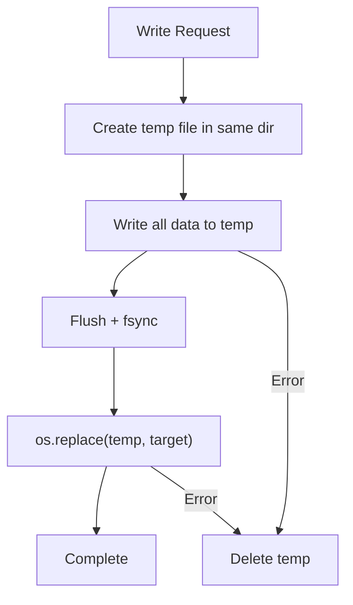

# LOCKMATE Hackathon Study Guide — Document 6
## Output Generation — Serializer, Atomic Write, Reports, Records

---

### 6.1 Output Module Overview

| Module | File | Lines | Purpose |
|--------|------|-------|---------|
| Serializer | `serializer.py` | 160 | Sanitized JSON/JSONL serialization |
| Atomic Write | `atomic_write.py` | 230 | Race-condition-free file writes |
| Report Generator | `report_generator.py` | 241 | `report.json` pipeline summary |
| Records Generator | `records_generator.py` | 270 | `records.jsonl` sharded data output |

---

### 6.2 Output Serializer (`serializer.py`)

#### 6.2.1 Purpose
Sanitize and serialize parsed records for safe output. Handles:
- Special float values (NaN, Infinity)
- UUID/datetime serialization
- Binary data encoding
- Key sanitization

#### 6.2.2 Configuration

```python
class SerializerConfig(BaseModel):
    default_encoding: str = "utf-8"
    ensure_ascii: bool = False          # Allow Unicode in output
    sort_keys: bool = True              # Deterministic output
    indent: int | None = None           # None = compact, 2 = pretty
    nan_str: str = "null"               # JSON doesn't support NaN
    infinity_str: str = "null"          # JSON doesn't support Infinity
    minus_infinity_str: str = "null"
    default_serializer: Callable | None = None  # Custom type handler
```

#### 6.2.3 Sanitization Logic

```python
def sanitize(self, obj: Any) -> Any:
    """Recursively sanitize for JSON serialization."""
    if obj is None or isinstance(obj, (bool, int, str)):
        return obj
    
    if isinstance(obj, float):
        if math.isnan(obj):
            return None  # → "null" in JSON
        if math.isinf(obj):
            return None if obj > 0 else None
    
    if isinstance(obj, (UUID, datetime, date)):
        return obj.isoformat()
    
    if isinstance(obj, bytes):
        return base64.b64encode(obj).decode("ascii")
    
    if isinstance(obj, dict):
        return {self._sanitize_key(k): self.sanitize(v) for k, v in obj.items()}
    
    if isinstance(obj, (list, tuple, set)):
        return [self.sanitize(item) for item in obj]
    
    # Fallback: try __dict__ or str()
    if hasattr(obj, "__dict__"):
        return self.sanitize(obj.__dict__)
    
    return str(obj)

def _sanitize_key(self, key: str) -> str:
    # Replace invalid JSON key chars
    return re.sub(r"[^\w\-]", "_", str(key))
```

#### 6.2.4 Serialization Methods

```python
def serialize_json(self, obj: Any) -> str:
    """Serialize to JSON string."""
    sanitized = self.sanitize(obj)
    return json.dumps(sanitized, ensure_ascii=self.config.ensure_ascii,
                      sort_keys=self.config.sort_keys, indent=self.config.indent)

def serialize_jsonl(self, records: Iterator[dict]) -> Iterator[str]:
    """Serialize iterator to JSONL lines."""
    for record in records:
        yield self.serialize_json(record)

def write_json(self, obj: Any, path: Path) -> None:
    """Write JSON to file (uses AtomicWriter)."""
    self.atomic_writer.write_text(path, self.serialize_json(obj))

def write_jsonl(self, records: Iterator[dict], path: Path) -> None:
    """Write JSONL to file (uses AtomicWriter)."""
    def line_gen():
        for record in records:
            yield self.serialize_json(record) + "\n"
    self.atomic_writer.write_lines(path, line_gen())
```

---

### 6.3 Atomic Writer (`atomic_write.py`)

#### 6.3.1 Purpose
Prevent partial/corrupted writes via atomic `os.replace()` (POSIX) / `MoveFileEx` (Windows).



#### 6.3.2 Configuration

```python
class AtomicWriteConfig(BaseModel):
    overwrite: bool = False           # Fail if target exists
    mode: int = 0o644                 # File permissions
    fsync: bool = True                # Force to disk
    temp_prefix: str = ".tmp_"        # Temp file prefix
    temp_suffix: str = ""             # Temp file suffix
```

#### 6.3.3 Implementation

```python
class AtomicWriter:
    def __init__(self, config: AtomicWriteConfig | None = None) -> None:
        self.config = config or AtomicWriteConfig()

    def write_text(self, path: Path, content: str, encoding: str = "utf-8") -> None:
        self._write(path, lambda f: f.write(content), encoding=encoding)

    def write_bytes(self, path: Path, content: bytes) -> None:
        self._write(path, lambda f: f.write(content))

    def write_lines(self, path: Path, lines: Iterator[str], encoding: str = "utf-8") -> None:
        self._write(path, lambda f: f.writelines(lines), encoding=encoding)

    def _write(self, path: Path, writer: Callable, encoding: str | None = None) -> None:
        path = Path(path)
        path.parent.mkdir(parents=True, exist_ok=True)
        
        # Check overwrite policy
        if path.exists() and not self.config.overwrite:
            raise FileExistsError(f"File exists and overwrite=False: {path}")
        
        # Create temp file in SAME directory (required for atomic replace)
        with tempfile.NamedTemporaryFile(
            mode="w" if encoding else "wb",
            dir=path.parent,
            prefix=self.config.temp_prefix,
            suffix=self.config.temp_suffix,
            delete=False,
            encoding=encoding
        ) as tmp:
            tmp_path = Path(tmp.name)
            try:
                writer(tmp)
                tmp.flush()
                if self.config.fsync:
                    os.fsync(tmp.fileno())
            except Exception:
                tmp_path.unlink(missing_ok=True)
                raise
        
        # Atomic replace
        try:
            os.replace(tmp_path, path)
        except Exception:
            tmp_path.unlink(missing_ok=True)
            raise
```

#### 6.3.4 Why Same Directory?
- `os.replace()` is atomic **only within same filesystem**
- Cross-device moves are NOT atomic
- Temp file in same directory guarantees same filesystem

---

### 6.4 Report Generator (`report_generator.py`)

#### 6.4.1 Purpose
Generate `report.json` — complete pipeline execution summary.

#### 6.4.2 Data Model

```python
class IngestionReport(BaseModel):
    job_id: UUID
    started_at: datetime
    finished_at: datetime | None = None
    success: bool = False
    
    # File counts
    total_files: int = 0
    processed_files: int = 0
    failed_files: int = 0
    quarantined_files: int = 0
    
    # Record counts
    total_records: int = 0
    records_by_format: dict[str, int] = Field(default_factory=dict)
    
    # Error tracking
    errors: list[dict[str, Any]] = Field(default_factory=list)
    quarantined: list[dict[str, Any]] = Field(default_factory=list)
    
    # Performance
    duration_seconds: float = 0.0
    throughput_records_per_sec: float = 0.0
    
    # Configuration snapshot
    config_snapshot: dict[str, Any] = Field(default_factory=dict)
```

#### 6.4.3 Generation Flow

```python
class ReportGenerator:
    def __init__(self, config: ReportConfig) -> None:
        self.config = config
        self.report: IngestionReport | None = None

    def start(self, config_snapshot: dict) -> None:
        self.report = IngestionReport(
            job_id=uuid4(),
            started_at=datetime.utcnow(),
            config_snapshot=config_snapshot
        )

    def add_file_processed(self, file_path: Path, records: int, mime_type: str, duration: float) -> None:
        self.report.total_files += 1
        self.report.processed_files += 1
        self.report.total_records += records
        self.report.records_by_format[mime_type] = self.report.records_by_format.get(mime_type, 0) + records
        # Track individual file stats if enabled

    def add_file_failed(self, file_path: Path, error: str) -> None:
        self.report.total_files += 1
        self.report.failed_files += 1
        self.report.errors.append({"file": str(file_path), "error": error})

    def add_file_quarantined(self, file_path: Path, reason: str, mime_type: str = "") -> None:
        self.report.total_files += 1
        self.report.quarantined_files += 1
        self.report.quarantined.append({
            "file": str(file_path),
            "reason": reason,
            "mime_type": mime_type
        })

    def finish(self, success: bool) -> IngestionReport:
        self.report.finished_at = datetime.utcnow()
        self.report.success = success
        self.report.duration_seconds = (self.report.finished_at - self.report.started_at).total_seconds()
        if self.report.duration_seconds > 0:
            self.report.throughput_records_per_sec = self.report.total_records / self.report.duration_seconds
        return self.report

    def write_report(self, output_path: Path) -> None:
        # Uses AtomicWriter
        self.atomic_writer.write_text(output_path, self.report.model_dump_json(indent=2))
```

#### 6.4.4 Example `report.json`

```json
{
  "job_id": "a1b2c3d4-e5f6-7890-abcd-ef1234567890",
  "started_at": "2026-01-15T10:00:00Z",
  "finished_at": "2026-01-15T10:00:05Z",
  "success": true,
  "total_files": 5,
  "processed_files": 4,
  "failed_files": 0,
  "quarantined_files": 1,
  "total_records": 1250,
  "records_by_format": {
    "text/csv": 500,
    "application/json": 700,
    "text/plain": 50
  },
  "errors": [],
  "quarantined": [
    {
      "file": "/data/input/bad.exe",
      "reason": "Disallowed MIME type: application/x-executable",
      "mime_type": "application/x-executable"
    }
  ],
  "duration_seconds": 5.23,
  "throughput_records_per_sec": 239.0,
  "config_snapshot": {
    "max_file_size": 104857600,
    "allowed_mime_types": ["text/csv", "application/json", "text/plain"]
  }
}
```

---

### 6.5 Records Generator (`records_generator.py`)

#### 6.5.1 Purpose
Generate `records.jsonl` — sharded output of all parsed records.

#### 6.5.2 Sharding Strategy

```python
class RecordsConfig(BaseModel):
    output_dir: Path
    max_records_per_file: int = 100_000    # Shard size
    max_file_size: int = 100 * 1024 * 1024 # 100MB
    filename_template: str = "records_{index:04d}.jsonl"
    include_metadata: bool = True          # Add _meta field to each record
    compress: bool = False                 # gzip output
```

#### 6.5.3 Record Format

```json
{
  "_meta": {
    "source_file": "patients.csv",
    "row_number": 42,
    "format": "csv",
    "ingested_at": "2026-01-15T10:00:01Z",
    "record_id": "a1b2c3d4-e5f6-7890-abcd-ef1234567890"
  },
  "patient_id": "PAT-001",
  "name": "John Doe",
  "dob": "1980-01-15"
}
```

#### 6.5.4 Implementation

```python
class RecordsGenerator:
    def __init__(self, config: RecordsConfig) -> None:
        self.config = config
        self.current_file: Path | None = None
        self.current_writer = None
        self.current_count = 0
        self.file_index = 0

    def write_records(self, records: Iterator[dict], filename: str | None = None) -> list[Path]:
        """Write records, sharding as needed. Returns list of output files."""
        output_files = []
        
        for record in records:
            # Add metadata if enabled
            if self.config.include_metadata:
                record = self._add_metadata(record)
            
            # Check shard boundaries
            if self._should_rotate():
                self._close_current()
                self._open_new_file()
            
            # Write record
            self.current_writer.write(self.serializer.serialize_json(record) + "\n")
            self.current_count += 1
        
        self._close_current()
        return output_files

    def _should_rotate(self) -> bool:
        if self.current_count >= self.config.max_records_per_file:
            return True
        if self.current_file and self.current_file.stat().st_size >= self.config.max_file_size:
            return True
        return False

    def _open_new_file(self) -> None:
        self.file_index += 1
        if self.config.filename_template:
            fname = self.config.filename_template.format(index=self.file_index)
        else:
            fname = f"records_{self.file_index:04d}.jsonl"
        self.current_file = self.config.output_dir / fname
        self.current_writer = open(self.current_file, "w", encoding="utf-8")
        self.current_count = 0

    def _close_current(self) -> None:
        if self.current_writer:
            self.current_writer.close()
            self.current_writer = None
            self.current_file = None
```

---

### 6.6 Output Directory Structure

```
output/
├── report.json                    # Pipeline execution report
├── records_0001.jsonl             # Shard 1 (≤100k records)
├── records_0002.jsonl             # Shard 2
├── ...
└── <input_stem>.jsonl             # Per-file output (legacy mode)
```

---

### 6.7 Integration with Pipeline

```python
# In SecureIngestionPipeline.__init__()
self.report_gen = ReportGenerator(config=ReportConfig(
    output_dir=config.output_dir,
    include_file_details=True
))
self.records_gen = RecordsGenerator(config=RecordsConfig(
    output_dir=config.output_dir,
    max_records_per_file=config.max_records_per_file
))

# In _process_file()
records = list(parser.parse(safe_path, encoding=validation_result.encoding))
if records:
    # Per-file output (for traceability)
    self.records_gen.write_records(iter(records), filename=f"{file_path.stem}.jsonl")

# In run()
self.report_gen.start(config_snapshot)
# ... process files ...
report = self.report_gen.finish(success=True)
self.report_gen.write_report(config.output_dir / "report.json")
```

---

### 6.8 Test Coverage (`test_output.py`)

| Test | Scenario | Assertions |
|------|----------|------------|
| `test_atomic_write_text` | Basic text write | File exists, content matches |
| `test_atomic_write_overwrite` | overwrite=True | Replaces existing |
| `test_atomic_write_no_overwrite` | overwrite=False | Raises FileExistsError |
| `test_atomic_write_fsync` | fsync=True | Data on disk after |
| `test_atomic_write_error_cleanup` | Write fails mid-way | No temp file left |
| `test_serializer_sanitize` | NaN, UUID, datetime | All converted to JSON-safe |
| `test_serializer_bytes` | Binary data | Base64 encoded |
| `test_report_generation` | Full pipeline run | report.json valid schema |
| `test_records_sharding` | >100k records | Multiple shards created |
| `test_records_metadata` | include_metadata=True | _meta field present |

---

### 6.9 Configuration Reference

```python
# In IngestionConfig (via SecureIngestionPipeline)
config = IngestionConfig(
    output_dir=Path("/data/output"),
    
    # Report settings
    report=ReportConfig(
        output_dir=Path("/data/output"),
        include_file_details=True
    ),
    
    # Records settings
    records=RecordsConfig(
        output_dir=Path("/data/output"),
        max_records_per_file=100_000,
        max_file_size=100 * 1024 * 1024,
        include_metadata=True,
        compress=False
    ),
    
    # Serializer settings
    serializer=SerializerConfig(
        ensure_ascii=False,
        sort_keys=True,
        indent=None  # Compact
    ),
    
    # Atomic write settings
    atomic_write=AtomicWriteConfig(
        overwrite=False,
        fsync=True
    )
)
```