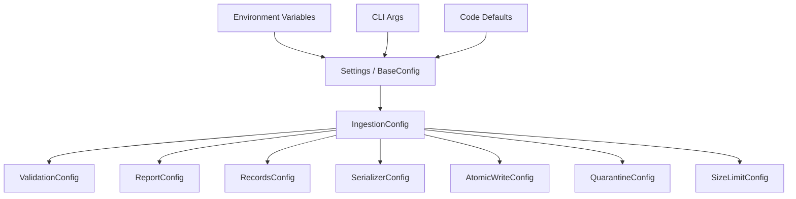

# LOCKMATE Hackathon Study Guide — Document 7
## Configuration & Data Models — Pydantic v2 Deep Dive

---

### 7.1 Configuration Architecture

All configuration uses **Pydantic v2** (`BaseModel`, `ConfigDict`, `Field`) for:
- Type validation at startup
- Environment variable override support
- Serialization for report snapshots
- IDE autocomplete support



---

### 7.2 Core Configuration Models

#### 7.2.1 `IngestionConfig` — Main Entry Point

```python
# src/lockmate/ingestion/secure_ingest.py
class IngestionConfig(BaseModel):
    model_config = ConfigDict(arbitrary_types_allowed=True)
    
    # === REQUIRED PATHS ===
    input_dir: Path
    output_dir: Path
    quarantine_dir: Path
    allowed_roots: list[Path] = Field(default_factory=list)
    
    # === RESOURCE LIMITS ===
    max_file_size: int = 100 * 1024 * 1024        # 100MB
    max_total_size: int = 1024 * 1024 * 1024      # 1GB
    follow_symlinks: bool = False
    
    # === SUB-CONFIGS ===
    validation: ValidationConfig = Field(default_factory=ValidationConfig)
    report: ReportConfig = Field(default_factory=lambda: ReportConfig(output_dir=Path(".")))
    records: RecordsConfig = Field(default_factory=lambda: RecordsConfig(output_dir=Path(".")))
    serializer: SerializerConfig = Field(default_factory=SerializerConfig)
    atomic_write: AtomicWriteConfig = Field(default_factory=AtomicWriteConfig)
    quarantine: QuarantineConfig = Field(default_factory=QuarantineConfig)
    size_limits: SizeLimitConfig = Field(default_factory=SizeLimitConfig)
```

#### 7.2.2 `ValidationConfig` — File Validator Settings

```python
# src/lockmate/ingestion/validation/file_validator.py
class ValidationConfig(BaseModel):
    allowed_mime_types: list[str] = Field(default_factory=lambda: [
        "text/csv",
        "text/tab-separated-values",
        "application/json",
        "application/x-ndjson",
        "application/fhir+json",
        "text/plain"
    ])
    allowed_encodings: list[str] = Field(default_factory=lambda: [
        "utf-8", "utf-16", "ascii", "latin-1", "iso-8859-1"
    ])
    max_file_size: int = 100 * 1024 * 1024
    validate_structure: bool = True
```

#### 7.2.3 `SizeLimitConfig` — Size Limiter Settings

```python
# src/lockmate/ingestion/validation/size_limits.py
class SizeLimitConfig(BaseModel):
    max_file_size: int = 100 * 1024 * 1024      # 100MB
    max_total_size: int = 1024 * 1024 * 1024    # 1GB
    max_memory: int = 512 * 1024 * 1024         # 512MB
```

#### 7.2.4 `QuarantineConfig` — Quarantine Settings

```python
# src/lockmate/ingestion/validation/quarantine.py
@dataclass
class QuarantineConfig:
    quarantine_path: Path = Path("quarantine")
    max_quarantine_size: int = 10 * 1024 * 1024 * 1024  # 10GB
    retention_days: int = 30
    compress: bool = True
```

#### 7.2.5 `ReportConfig` — Report Generator Settings

```python
# src/lockmate/ingestion/output/report_generator.py
class ReportConfig(BaseModel):
    output_dir: Path
    include_file_details: bool = True
    include_config_snapshot: bool = True
```

#### 7.2.6 `RecordsConfig` — Records Generator Settings

```python
# src/lockmate/ingestion/output/records_generator.py
class RecordsConfig(BaseModel):
    output_dir: Path
    max_records_per_file: int = 100_000
    max_file_size: int = 100 * 1024 * 1024
    filename_template: str = "records_{index:04d}.jsonl"
    include_metadata: bool = True
    compress: bool = False
```

#### 7.2.7 `SerializerConfig` — Serializer Settings

```python
# src/lockmate/ingestion/output/serializer.py
class SerializerConfig(BaseModel):
    default_encoding: str = "utf-8"
    ensure_ascii: bool = False
    sort_keys: bool = True
    indent: int | None = None
    nan_str: str = "null"
    infinity_str: str = "null"
    minus_infinity_str: str = "null"
    default_serializer: Callable | None = None
```

#### 7.2.8 `AtomicWriteConfig` — Atomic Writer Settings

```python
# src/lockmate/ingestion/output/atomic_write.py
class AtomicWriteConfig(BaseModel):
    overwrite: bool = False
    mode: int = 0o644
    fsync: bool = True
    temp_prefix: str = ".tmp_"
    temp_suffix: str = ""
```

---

### 7.3 Data Models

#### 7.3.1 `IngestionResult` — Pipeline Return Value

```python
# src/lockmate/ingestion/secure_ingest.py
class IngestionResult(BaseModel):
    job_id: UUID = Field(default_factory=uuid4)
    started_at: datetime = Field(default_factory=datetime.utcnow)
    finished_at: datetime | None = None
    success: bool = False
    total_records: int = 0
    processed_files: list[str] = Field(default_factory=list)
    failed_files: list[str] = Field(default_factory=list)
    quarantined_files: list[str] = Field(default_factory=list)
    errors: list[dict[str, Any]] = Field(default_factory=list)
```

#### 7.3.2 `ValidationResult` — File Validator Return

```python
# src/lockmate/ingestion/validation/file_validator.py
@dataclass
class ValidationResult:
    is_valid: bool
    reason: str
    mime_type: str
    details: dict[str, Any]
    
    # Example valid:
    # ValidationResult(True, "Valid", "text/csv", {"encoding": "utf-8"})
    # Example invalid:
    # ValidationResult(False, "Disallowed MIME type", "application/x-executable", {})
```

#### 7.3.3 `QuarantineEntry` — Quarantine Record

```python
# src/lockmate/ingestion/validation/quarantine.py
@dataclass
class QuarantineEntry:
    original_path: str
    original_name: str
    quarantine_path: str
    reason: str
    id: UUID = field(default_factory=uuid4)
    timestamp: datetime = field(default_factory=datetime.utcnow)
    file_size: int = 0
    mime_type: str = ""
    details: dict = field(default_factory=dict)
```

#### 7.3.4 `IngestedRecord` — Shared Interface (for Detection/Linkage/Privacy)

```python
# docs/INTERFACES.md (PLANNED - not yet in code)
class IngestedRecord(BaseModel):
    record_id: UUID = Field(default_factory=uuid4)
    source_file: str
    format: str                    # csv, json, fhir, text
    row_number: int | None = None
    ingested_at: datetime = Field(default_factory=datetime.utcnow)
    data: dict[str, Any]
    metadata: dict[str, Any] = Field(default_factory=dict)
```

#### 7.3.5 `IngestedBatch` — Shared Interface

```python
# docs/INTERFACES.md (PLANNED)
class IngestedBatch(BaseModel):
    batch_id: UUID = Field(default_factory=uuid4)
    ingestion_job_id: UUID
    records: list[IngestedRecord]
    created_at: datetime = Field(default_factory=datetime.utcnow)
    total_records: int
    source_files: list[str]
    config_snapshot: dict[str, Any]
```

---

### 7.4 Parser Configuration Models

#### 7.4.1 `CSVParserConfig`

```python
# src/lockmate/ingestion/parsers/csv_parser.py
class CSVParserConfig(BaseModel):
    delimiter: str = ","
    has_header: bool = True
    encoding: str = "utf-8"
    skip_blank_lines: bool = True
    max_rows: int | None = None
    quote_char: str = '"'
    escape_char: str = "\\"
    dtype: dict | None = None
    na_values: list[str] | None = None
    keep_default_na: bool = True
```

#### 7.4.2 `JSONParserConfig`

```python
# src/lockmate/ingestion/parsers/json_parser.py
class JSONParserConfig(BaseModel):
    use_orjson: bool = True
    max_depth: int = 100
    max_file_size: int = 100 * 1024 * 1024
    array_mode: str = "items"  # "items" | "whole"
    encoding: str = "utf-8"
```

#### 7.4.3 `TextParserConfig`

```python
# src/lockmate/ingestion/parsers/text_parser.py
class TextParserConfig(BaseModel):
    encoding: str = "utf-8"
    max_line_length: int = 1_000_000
    skip_empty_lines: bool = True
    strip_whitespace: bool = True
    line_mode: str = "lines"  # "lines" | "whole"
```

#### 7.4.4 `FHIRParserConfig`

```python
# src/lockmate/ingestion/parsers/fhir_parser.py
class FHIRParserConfig(BaseModel):
    encoding: str = "utf-8"
    validate_resources: bool = True
    extract_references: bool = True
    flatten: bool = False
    bundle_mode: str = "entries"  # "entries" | "bundle"
```

---

### 7.5 Environment Variable Override

Pydantic Settings can load from environment:

```python
# Example: settings.py (not yet implemented, but pattern)
from pydantic_settings import BaseSettings

class LockmateSettings(BaseSettings):
    model_config = SettingsConfigDict(env_prefix="LOCKMATE_", case_sensitive=False)
    
    input_dir: Path = Path("./data/input")
    output_dir: Path = Path("./data/output")
    quarantine_dir: Path = Path("./data/quarantine")
    max_file_size: int = 100 * 1024 * 1024
    log_level: str = "INFO"
    
# Usage:
# export LOCKMATE_INPUT_DIR=/data/input
# export LOCKMATE_MAX_FILE_SIZE=52428800
# settings = LockmateSettings()
```

---

### 7.6 Configuration Validation at Startup

```python
# In SecureIngestionPipeline.__init__()
def __init__(self, config: IngestionConfig) -> None:
    # 1. Validate required directories exist
    if not config.input_dir.exists():
        raise ValueError(f"Input directory does not exist: {config.input_dir}")
    if not config.input_dir.is_dir():
        raise ValueError(f"Input path is not a directory: {config.input_dir}")
    
    # 2. Create output/quarantine dirs
    config.output_dir.mkdir(parents=True, exist_ok=True)
    config.quarantine_dir.mkdir(parents=True, exist_ok=True)
    
    # 3. Validate allowed_roots
    if not config.allowed_roots:
        config.allowed_roots = [config.input_dir]
    for root in config.allowed_roots:
        if not root.exists():
            logger.warning(f"Allowed root does not exist: {root}")
    
    # 4. Initialize sub-components with validated config
    self.path_guard = PathGuard(allowed_roots=config.allowed_roots)
    self.size_limiter = SizeLimiter(max_file_size=config.max_file_size)
    # ...
```

---

### 7.7 Configuration Best Practices

| Practice | Example |
|----------|---------|
| **Explicit allowlists** | `allowed_roots=[Path("/data/input")]` not `["/"]` |
| **Conservative defaults** | 100MB file limit, not unlimited |
| **Fail closed** | `follow_symlinks=False` by default |
| **Snapshot config in report** | `config_snapshot` for reproducibility |
| **Separate sub-configs** | Each module owns its config class |
| **Type-safe paths** | `Path` objects, not strings |

---

### 7.8 Creating Custom Configuration

```python
# 1. Define config model
class CustomParserConfig(BaseModel):
    custom_option: str = "default"
    threshold: int = 100

# 2. Add to IngestionConfig (or create separate)
class IngestionConfig(BaseModel):
    custom_parser: CustomParserConfig = Field(default_factory=CustomParserConfig)
    # ...

# 3. Pass to parser
parser = CustomParser(config=config.custom_parser)
```

---

### 7.9 Configuration Test Coverage

| Test File | Coverage |
|-----------|----------|
| `test_integration.py` | Full pipeline with various configs |
| `test_*_parser.py` | Each parser with its config variants |
| `test_file_validator.py` | ValidationConfig variations |
| `test_quarantine.py` | QuarantineConfig options |
| `test_output.py` | ReportConfig, RecordsConfig, SerializerConfig |

---

### 7.10 Quick Reference: All Config Classes

| Class | File | Used By |
|-------|------|---------|
| `IngestionConfig` | `secure_ingest.py` | Pipeline entry point |
| `ValidationConfig` | `file_validator.py` | FileValidator |
| `SizeLimitConfig` | `size_limits.py` | SizeLimiter |
| `QuarantineConfig` | `quarantine.py` | QuarantineManager |
| `ReportConfig` | `report_generator.py` | ReportGenerator |
| `RecordsConfig` | `records_generator.py` | RecordsGenerator |
| `SerializerConfig` | `serializer.py` | OutputSerializer |
| `AtomicWriteConfig` | `atomic_write.py` | AtomicWriter |
| `CSVParserConfig` | `csv_parser.py` | CSVParser/TSVParser |
| `JSONParserConfig` | `json_parser.py` | JSONParser/NestedJSONParser |
| `TextParserConfig` | `text_parser.py` | TextParser |
| `FHIRParserConfig` | `fhir_parser.py` | FHIRParser |