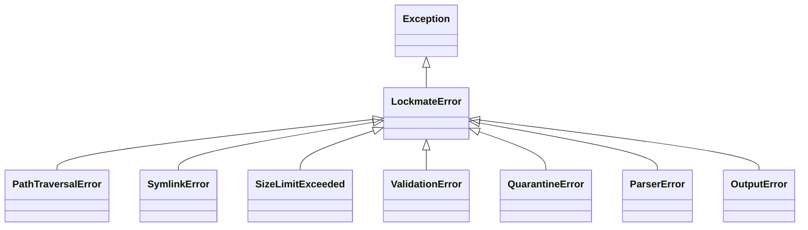

# LOCKMATE Hackathon Study Guide — Document 9
## Error Handling & Logging — Exception Hierarchy, structlog

---

### 9.1 Exception Hierarchy



#### 9.1.1 Base Exception

```python
# src/lockmate/ingestion/exceptions.py (implied - defined inline in each module)
class LockmateError(Exception):
    """Base exception for all LOCKMATE errors."""
    def __init__(self, message: str, details: dict | None = None):
        self.details = details or {}
        super().__init__(message)
```

#### 9.1.2 Security Exceptions

```python
# path_guard.py
class PathTraversalError(LockmateError):
    def __init__(self, path: Path, reason: str):
        self.path = path
        self.reason = reason
        super().__init__(f"Path traversal: {path} - {reason}", 
                         {"path": str(path), "reason": reason})

# symlink_guard.py
class SymlinkError(LockmateError):
    def __init__(self, path: Path, reason: str):
        self.path = path
        self.reason = reason
        super().__init__(f"Symlink error: {path} - {reason}",
                         {"path": str(path), "reason": reason})

# size_limits.py
class SizeLimitExceeded(LockmateError):
    def __init__(self, path: Path | None, actual: int, limit: int, limit_type: str):
        self.path = path
        self.actual = actual
        self.limit = limit
        self.limit_type = limit_type
        super().__init__(
            f"{limit_type} size limit exceeded: {actual} > {limit}",
            {"path": str(path) if path else None, "actual": actual, "limit": limit, "type": limit_type}
        )
```

#### 9.1.3 Validation & Processing Exceptions

```python
# file_validator.py (uses ValidationResult instead of exceptions)
# But parser can raise:
class ParserError(LockmateError):
    def __init__(self, path: Path, reason: str, original_error: Exception | None = None):
        self.path = path
        self.reason = reason
        self.original_error = original_error
        super().__init__(f"Parse error in {path}: {reason}",
                         {"path": str(path), "reason": reason})

# quarantine.py
class QuarantineError(LockmateError):
    def __init__(self, path: Path, reason: str):
        self.path = path
        super().__init__(f"Quarantine failed for {path}: {reason}")

# output modules
class OutputError(LockmateError):
    def __init__(self, path: Path, reason: str):
        self.path = path
        super().__init__(f"Output error for {path}: {reason}")
```

---

### 9.2 Error Handling Patterns

#### 9.2.1 Pipeline-Level (SecureIngestionPipeline)

```python
def _process_file(self, file_path: Path, result: IngestionResult) -> None:
    try:
        # Layer 1-4: Security validation
        safe_path = self.path_guard.validate(file_path)
        self.symlink_guard.check(safe_path)
        self.size_limiter.check(safe_path)
        validation_result = self.validator.validate(safe_path)
        
        if not validation_result.is_valid:
            self.quarantine.quarantine(safe_path, reason=validation_result.reason, ...)
            result.quarantined_files.append(str(file_path))
            self.report_gen.add_file_quarantined(file_path, validation_result.reason)
            return  # Continue to next file
        
        # Layer 5: Parsing
        parser = self._get_parser(validation_result.mime_type)
        records = list(parser.parse(safe_path, encoding=validation_result.encoding))
        
        # Output
        if records:
            self.records_gen.write_records(iter(records), filename=f"{file_path.stem}.jsonl")
        
        # Success tracking
        result.total_records += len(records)
        result.processed_files.append(str(file_path))
        self.report_gen.add_file_processed(file_path, len(records), ...)
        
    except PathTraversalError as e:
        self._handle_security_error(file_path, result, "Path traversal", e)
    except SymlinkError as e:
        self._handle_security_error(file_path, result, "Symlink", e)
    except SizeLimitExceeded as e:
        self._handle_security_error(file_path, result, "Size limit", e)
    except QuarantineError as e:
        logger.error("Quarantine failed", path=str(file_path), error=str(e))
        result.errors.append({"file": str(file_path), "error": f"Quarantine failed: {e}"})
    except Exception as e:
        # Catch-all for parser errors, I/O errors, etc.
        self.quarantine.quarantine(file_path, reason=f"Exception: {str(e)}")
        result.failed_files.append(str(file_path))
        result.errors.append({"file": str(file_path), "error": str(e)})
        logger.exception("File processing failed", path=str(file_path), error=str(e))
        # Re-raise if configured, or continue
        if self.config.fail_fast:
            raise

def _handle_security_error(self, file_path, result, error_type, exc):
    self.quarantine.quarantine(file_path, reason=f"{error_type}: {exc.reason}")
    result.failed_files.append(str(file_path))
    result.errors.append({"file": str(file_path), "error": f"{error_type}: {exc.reason}"})
    logger.warning(f"{error_type} blocked", path=str(file_path), reason=exc.reason)
```

**Key Principles**:
1. **Per-file isolation**: One file failure doesn't stop pipeline
2. **Quarantine on any exception**: No file left unaccounted
3. **Structured logging**: Every error logged with context
4. **Fail-fast option**: Configurable for critical deployments

#### 9.2.2 Parser-Level

```python
# csv_parser.py
def parse(self, file_path, encoding=None) -> Iterator[dict]:
    try:
        for chunk in pd.read_csv(..., chunksize=10000, encoding=encoding):
            for _, row in chunk.iterrows():
                yield self._sanitize_row(row.to_dict())
    except UnicodeDecodeError as e:
        raise ParserError(file_path, f"Encoding error: {e}", e)
    except pd.errors.ParserError as e:
        raise ParserError(file_path, f"CSV parse error: {e}", e)
    except Exception as e:
        raise ParserError(file_path, f"Unexpected error: {e}", e)

# json_parser.py
def parse(self, file_path, encoding=None) -> Iterator[dict]:
    try:
        content = file_path.read_text(encoding=encoding)
        data = orjson.loads(content) if self.config.use_orjson else json.loads(content)
        # ... process ...
    except (orjson.JSONDecodeError, json.JSONDecodeError) as e:
        raise ParserError(file_path, f"Invalid JSON: {e}", e)
    except MemoryError as e:
        raise ParserError(file_path, "File too large for memory", e)
```

#### 9.2.3 Validation-Level (Result-Based, Not Exception-Based)

```python
# file_validator.py - returns ValidationResult, doesn't raise
def validate(self, path: Path) -> ValidationResult:
    if not path.exists():
        return ValidationResult(False, "File does not exist", "", {})
    # ... checks ...
    return ValidationResult(True, "Valid", mime_type, {"encoding": encoding})

# Caller handles:
validation_result = self.validator.validate(safe_path)
if not validation_result.is_valid:
    self.quarantine.quarantine(...)
    return  # Not an exception, just a result
```

---

### 9.3 Logging with structlog

#### 9.3.1 Configuration

```python
# Implicit in each module
import structlog
logger = structlog.get_logger()
```

**Default processors** (structlog defaults):
- `add_log_level`
- `add_logger_name`
- `TimeStamper(fmt="iso")`
- `StackInfoRenderer()`
- `format_exc_info`
- `JSONRenderer()` (when configured)

#### 9.3.2 Structured Logging Examples

```python
# In secure_ingest.py
logger.info("Starting ingestion pipeline", 
            job_id=str(self.config.job_id),
            input_dir=str(self.config.input_dir))

logger.info("File processed",
            path=str(file_path),
            records=len(records),
            mime_type=validation_result.mime_type,
            duration_ms=duration_ms)

logger.warning("File quarantined",
               path=str(file_path),
               reason=validation_result.reason,
               mime_type=validation_result.mime_type)

logger.error("Path traversal blocked",
             path=str(file_path),
             reason=exc.reason,
             allowed_roots=[str(r) for r in self.path_guard.allowed_roots])

logger.exception("Unexpected processing error",
                 path=str(file_path),
                 error_type=type(e).__name__)
```

#### 9.3.3 Log Output Format (JSON)

```json
{
  "timestamp": "2026-01-15T10:00:01.123Z",
  "level": "info",
  "logger": "lockmate.ingestion.secure_ingest",
  "event": "File processed",
  "path": "/data/input/patients.csv",
  "records": 150,
  "mime_type": "text/csv",
  "duration_ms": 45.2
}
```

```json
{
  "timestamp": "2026-01-15T10:00:02.456Z",
  "level": "warning",
  "logger": "lockmate.ingestion.secure_ingest",
  "event": "File quarantined",
  "path": "/data/input/malware.exe",
  "reason": "Disallowed MIME type: application/x-executable",
  "mime_type": "application/x-executable"
}
```

---

### 9.4 Error Codes for Integration

For Detection/Linkage/Privacy modules (PLANNED), standardize error reporting:

```python
# Proposed error code scheme
ERROR_CODES = {
    "PATH_TRAVERSAL": "SEC-001",
    "SYMLINK_BLOCKED": "SEC-002",
    "FILE_TOO_LARGE": "SEC-003",
    "BATCH_TOO_LARGE": "SEC-004",
    "INVALID_MIME": "VAL-001",
    "INVALID_ENCODING": "VAL-002",
    "STRUCTURE_INVALID": "VAL-003",
    "PARSE_FAILED": "PAR-001",
    "QUARANTINE_FAILED": "QUR-001",
    "OUTPUT_FAILED": "OUT-001",
    "ATOMIC_WRITE_FAILED": "OUT-002",
}

# In IngestionResult.errors:
{
    "file": "/data/input/bad.exe",
    "error": "Disallowed MIME type: application/x-executable",
    "error_code": "VAL-001",
    "timestamp": "2026-01-15T10:00:01Z"
}
```

---

### 9.5 Retry Logic (tenacity)

Used for transient failures (network, temporary locks):

```python
from tenacity import retry, stop_after_attempt, wait_exponential, retry_if_exception_type

@retry(
    stop=stop_after_attempt(3),
    wait=wait_exponential(multiplier=1, min=1, max=10),
    retry=retry_if_exception_type((IOError, OSError)),
    reraise=True
)
def _write_with_retry(self, path: Path, content: str) -> None:
    self.atomic_writer.write_text(path, content)
```

---

### 9.6 Debugging Guide

#### 9.6.1 Enable Debug Logging

```python
import structlog
structlog.configure(
    wrapper_class=structlog.make_filtering_bound_logger(logging.DEBUG),
    processors=[
        structlog.dev.ConsoleRenderer(colors=True)  # Pretty console
    ]
)
```

#### 9.6.2 Common Error Scenarios

| Error | Cause | Resolution |
|-------|-------|------------|
| `PathTraversalError` | File outside `allowed_roots` | Add parent dir to `allowed_roots` |
| `SymlinkError` | Symlink target outside roots | Set `follow_symlinks=True` + add target to roots |
| `SizeLimitExceeded` | File > `max_file_size` | Increase limit or split file |
| `ValidationResult(is_valid=False)` | MIME/encoding/structure | Check file format, add to allowlist |
| `ParserError: Invalid JSON` | Malformed JSON | Fix source or quarantine |
| `FileExistsError` | `overwrite=False` (default) | Set `overwrite=True` or remove existing |
| `ModuleNotFoundError: fhir.resources` | FHIR parser used without dep | `pip install fhir.resources` |

#### 9.6.3 Inspecting Quarantine

```python
# List quarantined files
from lockmate.ingestion.validation.quarantine import QuarantineManager
qm = QuarantineManager(config)
entries = qm.list_entries(limit=20)
for e in entries:
    print(f"{e.id}: {e.original_name} - {e.reason}")

# Restore for analysis
qm.restore(entry_id, Path("/tmp/analysis/"))
```

---

### 9.7 Testing Error Paths

```python
# test_error_handling.py
def test_path_traversal_logged(caplog):
    config = IngestionConfig(...)
    pipeline = SecureIngestionPipeline(config)
    
    # Create file with traversal attempt
    bad_file = input_dir / ".." / "etc" / "passwd"  # Won't work directly
    # Use symlink on Linux or mock
    
    with caplog.at_level(logging.WARNING):
        pipeline.run()
    
    assert "Path traversal blocked" in caplog.text
    assert "SEC-001" in caplog.text  # Error code

def test_quarantine_on_parse_error():
    # Create corrupt JSON
    bad_json = input_dir / "bad.json"
    bad_json.write_text("{ invalid json }")
    
    result = pipeline.run()
    
    assert len(result.quarantined_files) == 1
    assert "Parse error" in result.errors[0]["error"]
```