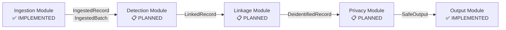

# LOCKMATE Hackathon Study Guide — Document 10
## Shared Interfaces — Ingestion → Detection/Linkage/Privacy Contracts

---

### 10.1 Interface Overview

**Source**: `docs/INTERFACES.md` (authoritative)

These interfaces define the **contract** between Developer 2 (Satwilk - Ingestion) and Developer 1 (Samridh - Detection/Linkage/Privacy). The Detection, Linkage, and Privacy modules are **PLANNED** — not yet implemented in the repository.



---

### 10.2 Data Model: `IngestedRecord`

**Purpose**: Standardized record produced by ingestion for downstream processing.

```python
# From docs/INTERFACES.md
from pydantic import BaseModel, Field
from datetime import datetime
from uuid import UUID, uuid4
from typing import Any

class IngestedRecord(BaseModel):
    """Standardized record produced by the ingestion module."""
    record_id: UUID = Field(default_factory=uuid4)
    source_file: str              # Original filename or path
    format: str                   # csv, json, fhir, text
    row_number: int | None = None # Row/Line number in source file
    ingested_at: datetime = Field(default_factory=datetime.utcnow)
    
    # Raw parsed data (sanitized, JSON-serializable)
    data: dict[str, Any]
    
    # Metadata about the ingestion
    metadata: dict[str, Any] = Field(default_factory=dict)
```

**Current Implementation** (in `records_generator.py` output):
```json
{
  "_meta": {
    "record_id": "a1b2c3d4-e5f6-7890-abcd-ef1234567890",
    "source_file": "patients.csv",
    "row_number": 42,
    "format": "csv",
    "ingested_at": "2026-01-15T10:00:01Z"
  },
  "patient_id": "PAT-001",
  "name": "John Doe",
  "dob": "1980-01-15"
}
```

**Mapping to `IngestedRecord`**:
| `IngestedRecord` Field | Current Output Location |
|------------------------|-------------------------|
| `record_id` | `_meta.record_id` |
| `source_file` | `_meta.source_file` |
| `format` | `_meta.format` |
| `row_number` | `_meta.row_number` |
| `ingested_at` | `_meta.ingested_at` |
| `data` | Root object (minus `_meta`) |
| `metadata` | `_meta` (additional fields) |

---

### 10.3 Data Model: `IngestedBatch`

**Purpose**: Collection of records from a single ingestion job.

```python
# From docs/INTERFACES.md
class IngestedBatch(BaseModel):
    batch_id: UUID = Field(default_factory=uuid4)
    ingestion_job_id: UUID        # Links to report.json job_id
    records: list[IngestedRecord]
    created_at: datetime = Field(default_factory=datetime.utcnow)
    total_records: int
    source_files: list[str]       # All source files in this batch
    config_snapshot: dict[str, Any]  # IngestionConfig for reproducibility
```

**Relationship to Current Output**:
- `report.json` contains `job_id` → maps to `ingestion_job_id`
- `records_*.jsonl` shards contain records → batch can be reconstructed
- `config_snapshot` in report → maps to `config_snapshot`

---

### 10.4 Interface: Ingestion → Detection

**Method**: File-based handoff (current) or direct call (future)

#### 10.4.1 File-Based (Current Implementation)

```
output/
├── report.json              # Job metadata, stats
├── records_0001.jsonl       # Records shard 1
├── records_0002.jsonl       # Records shard 2
└── ...
```

**Detection Module Reads**:
1. `report.json` for job context
2. All `records_*.jsonl` for records
3. Reconstructs `IngestedBatch` from shards

#### 10.4.2 Direct Call (Future)

```python
# Proposed API for Detection module
from lockmate.ingestion import SecureIngestionPipeline, IngestionConfig

# Option A: Get iterator of IngestedRecord
pipeline = SecureIngestionPipeline(config)
for record in pipeline.ingest_file(Path("data.csv")):
    detection.process(record)

# Option B: Get complete batch
batch = pipeline.run_and_get_batch()  # Returns IngestedBatch
detection.process_batch(batch)
```

---

### 10.5 Interface: Detection → Linkage

**PLANNED** — Not implemented

```python
# From docs/INTERFACES.md (proposed)
class LinkedRecord(BaseModel):
    record_id: UUID
    source_record_id: UUID           # Original IngestedRecord
    entity_id: str                   # Resolved entity identifier
    match_confidence: float          # 0.0 - 1.0
    matched_fields: list[str]        # Fields used for matching
    linkage_method: str              # deterministic, probabilistic, ML
    linked_at: datetime = Field(default_factory=datetime.utcnow)
    
    # All original data preserved
    data: dict[str, Any]
```

---

### 10.6 Interface: Linkage → Privacy

**PLANNED** — Not implemented

```python
# From docs/INTERFACES.md (proposed)
class DeidentifiedRecord(BaseModel):
    record_id: UUID
    linked_record_id: UUID
    entity_id: str
    
    # De-identified data (k-anonymity, differential privacy, etc.)
    data: dict[str, Any]
    
    # Privacy metadata
    privacy_method: str              # k-anonymity, l-diversity, DP, etc.
    privacy_params: dict[str, Any]   # k=5, epsilon=0.1, etc.
    risk_score: float                # Re-identification risk 0-1
    processed_at: datetime = Field(default_factory=datetime.utcnow)
```

---

### 10.7 Interface: Privacy → Output

**PLANNED** — Not implemented

```python
# From docs/INTERFACES.md (proposed)
class PrivacyOutputConfig(BaseModel):
    output_dir: Path
    format: str = "jsonl"            # jsonl, parquet, csv
    include_privacy_metadata: bool = True
    partition_by: str | None = None  # entity_id, date, etc.
```

---

### 10.8 Current Implementation Status

| Interface | Status | Location |
|-----------|--------|----------|
| `IngestedRecord` | ✅ Produced (as `_meta` + data) | `records_generator.py` |
| `IngestedBatch` | 📋 Reconstructable from output | `report.json` + `records_*.jsonl` |
| Ingestion → Detection | 📋 File-based handoff | `output/` directory |
| Detection → Linkage | ❌ Not implemented | — |
| Linkage → Privacy | ❌ Not implemented | — |
| Privacy → Output | ❌ Not implemented | — |

---

### 10.9 Integration Guide for Developer 1 (Samridh)

#### 10.9.1 Reading Current Output

```python
# detection/ingestion_reader.py
from pathlib import Path
import json
from uuid import UUID
from datetime import datetime
from typing import Iterator

class IngestedRecord:
    def __init__(self, record_id, source_file, format, row_number, ingested_at, data, metadata):
        self.record_id = record_id
        self.source_file = source_file
        self.format = format
        self.row_number = row_number
        self.ingested_at = ingested_at
        self.data = data
        self.metadata = metadata

def read_ingested_batch(output_dir: Path) -> Iterator[IngestedRecord]:
    """Read all records from ingestion output."""
    # Read report for context
    report_path = output_dir / "report.json"
    with open(report_path) as f:
        report = json.load(f)
    
    # Read all record shards
    for records_file in sorted(output_dir.glob("records_*.jsonl")):
        with open(records_file) as f:
            for line in f:
                record = json.loads(line)
                meta = record.pop("_meta", {})
                yield IngestedRecord(
                    record_id=UUID(meta.get("record_id")),
                    source_file=meta.get("source_file"),
                    format=meta.get("format"),
                    row_number=meta.get("row_number"),
                    ingested_at=datetime.fromisoformat(meta.get("ingested_at").replace("Z", "+00:00")),
                    data=record,
                    metadata=meta
                )
```

#### 10.9.2 Running Ingestion Programmatically

```python
# detection/run_ingestion.py
from lockmate.ingestion import SecureIngestionPipeline, IngestionConfig
from pathlib import Path

def run_ingestion(input_dir: Path, output_dir: Path) -> Path:
    config = IngestionConfig(
        input_dir=input_dir,
        output_dir=output_dir,
        quarantine_dir=output_dir / "quarantine",
        allowed_roots=[input_dir],
    )
    pipeline = SecureIngestionPipeline(config)
    result = pipeline.run()
    
    if not result.success:
        raise RuntimeError(f"Ingestion failed: {result.errors}")
    
    return output_dir / "report.json"
```

---

### 10.10 Contract Testing

**Proposed** — For when Detection module exists:

```python
# tests/test_ingestion_detection_contract.py
import pytest
from lockmate.ingestion import SecureIngestionPipeline, IngestionConfig
from pathlib import Path

class TestIngestionDetectionContract:
    def test_ingested_record_schema(self):
        """Verify IngestedRecord matches INTERFACES.md spec."""
        # Run ingestion on known test file
        # Parse output records
        # Validate against IngestedRecord model
        pass
    
    def test_batch_reconstruction(self):
        """Verify IngestedBatch can be reconstructed from output."""
        pass
    
    def test_config_snapshot_completeness(self):
        """Verify config_snapshot contains all IngestionConfig fields."""
        pass
```

---

### 10.11 Versioning Strategy

| Version | Ingestion Output | Detection Input |
|---------|------------------|-----------------|
| v1 (current) | `_meta` + data in JSONL | File-based read |
| v2 (planned) | Direct `IngestedRecord` iterator | Direct API call |
| v3 (future) | Streaming gRPC/HTTP | Service-to-service |

**Backward Compatibility**: Ingestion output format (JSONL + report.json) will remain stable. New fields added only, never removed.

---

### 10.12 Key Files for Interface Implementation

| File | Purpose |
|------|---------|
| `docs/INTERFACES.md` | Authoritative contract specification |
| `src/lockmate/ingestion/output/records_generator.py` | Produces `_meta` + data |
| `src/lockmate/ingestion/output/report_generator.py` | Produces `report.json` with `job_id` |
| `src/lockmate/ingestion/secure_ingest.py` | Pipeline entry point for programmatic use |
| `src/lockmate/ingestion/__init__.py` | Public exports |