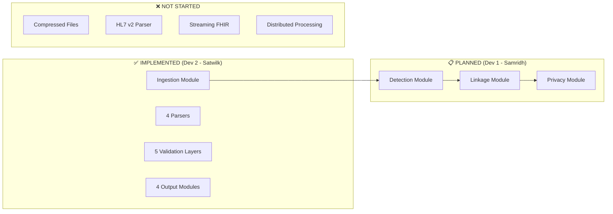
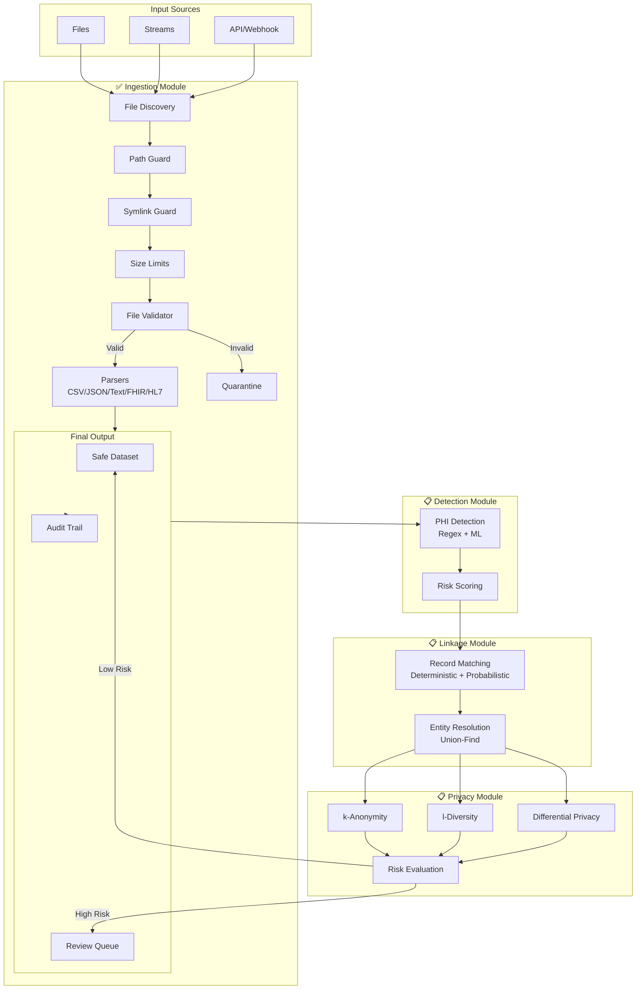

# LOCKMATE Hackathon Study Guide — Document 15
## Future Work — Detection, Linkage, Privacy Roadmap

---

### 15.1 Module Status Summary



---

### 15.2 Developer 1 (Samridh) Roadmap — Detection / Linkage / Privacy

These three modules are **PLANNED** — interfaces are defined in `docs/INTERFACES.md` but no code exists in the repository yet.

#### 15.2.1 Detection Module (PHI Detection & Entity Extraction)

**Objective**: Identify sensitive fields (PHI/PII) and extract healthcare entities from ingested records.

**Input** (from Ingestion): `IngestedRecord` / `IngestedBatch`  
**Output**: Annotated records with detected PHI locations and entity types

**Proposed Architecture**:

```python
# lockmate/detection/ (PLANNED)
from typing import Protocol
from pydantic import BaseModel
from uuid import UUID
from datetime import datetime

# --- Data Models ---
class PHIField(BaseModel):
    """A detected PHI field within a record."""
    field_path: str                 # e.g., "patient.name", "record.phone"
    phi_type: str                   # e.g., "name", "ssn", "date_of_birth", "medical_record_number", "address"
    confidence: float               # 0.0 - 1.0
    pattern: str                    # regex/rule identifier
    suggested_action: str           # "redact", "mask", "keep", "review"
    detected_at: datetime = Field(default_factory=datetime.utcnow)

class DetectionResult(BaseModel):
    record_id: UUID
    detected_fields: list[PHIField]
    has_phi: bool
    risk_score: float               # Aggregate re-identification risk

# --- Detection Strategies ---
class DetectionStrategy(Protocol):
    """Strategy pattern for different detection approaches."""
    def detect(self, record: dict) -> list[PHIField]:
        ...

class RegexDetectionStrategy(DetectionStrategy):
    """Regex-based PHI detection (PII patterns, NPI, SSN, etc.)."""
    patterns: dict[str, str] = {
        "ssn": r"\b\d{3}-\d{2}-\d{4}\b",
        "phone": r"\b(\+?1)?[-.\s]?\(?\d{3}\)?[-.\s]?\d{3}[-.\s]?\d{4}\b",
        "email": r"\b[A-Za-z0-9._%+-]+@[A-Za-z0-9.-]+\.[A-Z|a-z]{2,}\b",
        "npi": r"\b\d{10}\b",  # National Provider Identifier
        "mrn": r"\b(MRN|MR#|Patient ID)[:\s]+\w+",
        "date_of_birth": r"\b\d{4}-\d{2}-\d{2}\b",
    }
    
    def detect(self, record: dict) -> list[PHIField]:
        """Recursively scan nested dicts for PHI patterns."""
        results = []
        for key, value in self._flatten(record):
            for phi_type, pattern in self.patterns.items():
                if re.search(pattern, str(value)):
                    results.append(PHIField(
                        field_path=key,
                        phi_type=phi_type,
                        confidence=self._score_match(pattern, value),
                        pattern=phi_type,
                    ))
        return results

class MLDetectionStrategy(DetectionStrategy):
    """ML/NER-based detection (spaCy, clinical NLP)."""
    model: str = "en_core_web_sm"  # spaCy medical model
    
    def detect(self, record: dict) -> list[PHIField]:
        """Use NLP entity recognition for clinical text."""
        ...

class HybridDetectionStrategy(DetectionStrategy):
    """Combine regex + ML for higher precision/recall."""
    def __init__(self):
        self.regex = RegexDetectionStrategy()
        self.ml = MLDetectionStrategy()
    
    def detect(self, record: dict) -> list[PHIField]:
        regex_results = self.regex.detect(record)
        ml_results = self.ml.detect(record)
        return self._deduplicate_and_merge(regex_results, ml_results)

# --- Detector Orchestrator ---
class PHIDetector:
    """Main entry point for Detection module."""
    def __init__(self, strategy: DetectionStrategy | None = None):
        self.strategy = strategy or HybridDetectionStrategy()
    
    def process_batch(self, batch: IngestedBatch) -> list[DetectionResult]:
        """Process all records in a batch."""
        results = []
        for record in batch.records:
            results.append(self.process_record(record))
        return results
    
    def process_record(self, record: IngestedRecord) -> DetectionResult:
        phi_fields = self.strategy.detect(record.data)
        return DetectionResult(
            record_id=record.record_id,
            detected_fields=phi_fields,
            has_phi=len(phi_fields) > 0,
            risk_score=self._compute_risk(phi_fields),
        )
```

**Key Features**:
- Strategy pattern for pluggable detection (regex, ML, hybrid)
- Recursive nested-field scanning
- Confidence scoring per field
- Risk scoring for prioritization
- Configurable action recommendations (redact/mask/keep)

**Testing**:
```python
# tests/test_detection.py (PLANNED)
class TestRegexDetection:
    def test_detects_ssn(self):
        detector = RegexDetectionStrategy()
        fields = detector.detect({"patient": {"ssn": "123-45-6789"}})
        assert len(fields) == 1
        assert fields[0].phi_type == "ssn"
    
    def test_detects_phone(self):
        detector = RegexDetectionStrategy()
        fields = detector.detect({"contact": {"phone": "+1-555-123-4567"}})
        assert len(fields) == 1
    
    def test_nested_field_scanning(self):
        detector = RegexDetectionStrategy()
        data = {"patient": {"demographics": {"dob": "1980-01-15"}}}
        fields = detector.detect(data)
        assert fields[0].field_path == "patient.demographics.dob"
    
    def test_no_false_positives_clean_data(self):
        detector = RegexDetectionStrategy()
        fields = detector.detect({"name": "Test Data", "value": 42})
        assert len(fields) == 0

class TestPHIDetector:
    def test_detects_phi_in_batch(self):
        detector = PHIDetector(strategy=RegexDetectionStrategy())
        batch = IngestedBatch(records=[...])  # synthetic with PHI
        results = detector.process_batch(batch)
        assert all(r.has_phi for r in results)
    
    def test_risk_score_higher_for_more_fields(self):
        # Record with 3 PHI fields > record with 1
        ...
```

---

#### 15.2.2 Linkage Module (Record Linkage & Deduplication)

**Objective**: Match records belonging to the same entity (patient) across files/records, deduplicate, and build an entity-centric view.

**Input**: `DetectionResult`-annotated records  
**Output**: `LinkedRecord` with resolved entity_id and match confidence

**Proposed Architecture**:

```python
# lockmate/linkage/ (PLANNED)
from typing import Protocol
from pydantic import BaseModel
from uuid import UUID
from datetime import datetime

# --- Data Models ---
class MatchCandidate(BaseModel):
    """A potential match found during comparison."""
    source_record_id: UUID
    target_record_id: UUID
    score: float                    # 0.0 - 1.0
    matched_fields: list[str]
    method: str                     # "deterministic", "probabilistic", "ml"

class LinkedRecord(BaseModel):
    record_id: UUID
    source_record_id: UUID          # Original IngestedRecord
    entity_id: str                  # Resolved entity identifier
    match_confidence: float         # 0.0 - 1.0
    matched_fields: list[str]
    linkage_method: str
    linked_at: datetime = Field(default_factory=datetime.utcnow)
    data: dict                      # Original data preserved

# --- Matching Strategies ---
class MatchingStrategy(Protocol):
    def find_matches(self, record: dict, candidates: list[dict]) -> list[MatchCandidate]:
        ...

class DeterministicMatching(MatchingStrategy):
    """Exact match on key fields (e.g., MRN, SSN, combination)."""
    match_fields: list[str]         # e.g., ["patient_id", "dob"]
    
    def find_matches(self, record, candidates):
        matches = []
        for cand in candidates:
            if all(record.get(f) == cand.get(f) for f in self.match_fields):
                matches.append(MatchCandidate(
                    source_record_id=...,
                    target_record_id=...,
                    score=1.0,
                    matched_fields=self.match_fields,
                    method="deterministic",
                ))
        return matches

class ProbabilisticMatching(MatchingStrategy):
    """Fuzzy matching using Fellegi-Sunter model / Jaro-Winkler."""
    field_weights: dict[str, float] = {
        "last_name": 0.3,
        "first_name": 0.2,
        "dob": 0.2,
        "zip": 0.1,
        "phone": 0.1,
        "email": 0.1,
    }
    threshold: float = 0.7
    
    def _jaro_winkler(self, s1: str, s2: str) -> float:
        """Jaro-Winkler string similarity."""
        ...
    
    def find_matches(self, record, candidates):
        matches = []
        for cand in candidates:
            score = sum(
                self._jaro_winkler(str(record.get(f, "")), str(cand.get(f, ""))) * w
                for f, w in self.field_weights.items()
            )
            if score >= self.threshold:
                matches.append(MatchCandidate(
                    score=score,
                    method="probabilistic",
                ))
        return matches

class MLMatching(MatchingStrategy):
    """Machine-learning-based matching (embeddings, siamese networks)."""
    model_path: str = "models/entity_matcher.pt"
    
    def find_matches(self, record, candidates):
        """Use trained model to predict match probability."""
        ...

# --- Linker Orchestrator ---
class RecordLinker:
    """Main entry point for Linkage module."""
    def __init__(self, strategies: list[MatchingStrategy] | None = None):
        self.strategies = strategies or [
            DeterministicMatching(match_fields=["patient_id"]),
            ProbabilisticMatching(),
        ]
    
    def link_batch(self, batch: IngestedBatch) -> list[LinkedRecord]:
        """Resolve entity IDs for all records in batch."""
        # Build index, compare, resolve entity groups
        ...
    
    def _resolve_entities(self, matches: list[MatchCandidate]) -> dict[str, str]:
        """Union-Find to group records into entities."""
        ...
```

**Key Features**:
- Multi-strategy matching (deterministic + probabilistic + ML)
- Fellegi-Sunter probabilistic model
- Jaro-Winkler / Levenshtein fuzzy matching
- Union-Find entity resolution
- Confidence thresholding with manual review queue

---

#### 15.2.3 Privacy Module (De-identification & Anonymization)

**Objective**: Apply de-identification policies (k-anonymity, l-diversity, differential privacy) to linked records before output.

**Input**: `LinkedRecord`  
**Output**: `DeidentifiedRecord` with privacy metadata and risk score

**Proposed Architecture**:

```python
# lockmate/privacy/ (PLANNED)
from typing import Protocol
from pydantic import BaseModel
from uuid import UUID
from datetime import datetime

# --- Data Models ---
class PrivacyConfig(BaseModel):
    method: str                     # "k-anonymity", "l-diversity", "differential-privacy"
    k: int = 5                      # k-anonymity parameter
    l: int = 2                      # l-diversity parameter
    epsilon: float = 0.1            # DP privacy budget
    delta: float = 1e-6             # DP failure probability
    sensitive_fields: list[str] = ["diagnosis", "medication"]
    quasi_identifiers: list[str] = ["dob", "zip", "gender", "race"]

class DeidentifiedRecord(BaseModel):
    record_id: UUID
    linked_record_id: UUID
    entity_id: str
    data: dict                      # De-identified data
    privacy_method: str
    privacy_params: dict
    risk_score: float               # Re-identification risk 0-1
    processed_at: datetime = Field(default_factory=datetime.utcnow)

# --- De-identification Techniques ---
class DeidentificationTechnique(Protocol):
    def transform(self, record: dict, config: PrivacyConfig) -> dict:
        ...

class GeneralizationTechnique(DeidentificationTechnique):
    """Generalize quasi-identifiers (e.g., DOB → year, ZIP → 3-digit)."""
    generalization_map: dict[str, callable] = {
        "dob": lambda v: f"{v[:4]}-01-01",       # Year only
        "zip": lambda v: v[:3] + "***",          # 3-digit ZIP
    }
    
    def transform(self, record, config):
        transformed = dict(record)
        for field in config.quasi_identifiers:
            if field in transformed:
                transformed[field] = self.generalization_map[field](transformed[field])
        return transformed

class SuppressionTechnique(DeidentificationTechnique):
    """Suppress rare values to meet k-anonymity."""
    min_group_size: int = 5
    
    def transform(self, record, config):
        # Suppress values in groups < k
        ...

class DifferentialPrivacyTechnique(DeidentificationTechnique):
    """Add calibrated noise for differential privacy."""
    epsilon: float = 0.1
    
    def _laplace_noise(self, sensitivity: float) -> float:
        """Sample from Laplace distribution."""
        ...
    
    def transform(self, record, config):
        # Add noise to numerical fields, use exponential mechanism for categorical
        ...

# --- Privacy Orchestrator ---
class DeidentificationEngine:
    """Main entry point for Privacy module."""
    def __init__(self, config: PrivacyConfig):
        self.config = config
        self.technique = self._select_technique(config.method)
    
    def _select_technique(self, method: str) -> DeidentificationTechnique:
        return {
            "k-anonymity": GeneralizationTechnique(),
            "l-diversity": SuppressionTechnique(),
            "differential-privacy": DifferentialPrivacyTechnique(),
        }[method]
    
    def deidentify(self, linked_records: list[LinkedRecord]) -> list[DeidentifiedRecord]:
        """Apply privacy transformation to all linked records."""
        results = []
        for record in linked_records:
            transformed = self.technique.transform(record.data, self.config)
            results.append(DeidentifiedRecord(
                record_id=record.record_id,
                linked_record_id=record.record_id,
                entity_id=record.entity_id,
                data=transformed,
                privacy_method=self.config.method,
                privacy_params=self.config.model_dump(),
                risk_score=self._compute_risk(transformed),
            ))
        return results
    
    def _compute_risk(self, data: dict) -> float:
        """Compute re-identification risk score (0-1)."""
        # Based on k-anonymity: risk ≈ 1/k
        if self.config.method == "k-anonymity":
            return 1.0 / self.config.k
        # Differential privacy: risk ≈ exp(-epsilon)
        elif self.config.method == "differential-privacy":
            return math.exp(-self.config.epsilon)
        return 0.5
```

**Key Features**:
- Multiple de-identification techniques (k-anonymity, l-diversity, DP)
- Quasi-identifier generalization/suppression
- Laplace noise for DP
- Automated risk scoring
- Configurable policy per deployment

---

### 15.3 Developer 2 (Satwilk) Roadmap — Ingestion Enhancements

#### 15.3.1 Compressed File Support

**Objective**: Handle zip, gzip, tar, bz2 files with decompression-bomb protection.

**Status**: ❌ NOT IMPLEMENTED (currently quarantined as unknown MIME)

**Design**:

```python
# lockmate/ingestion/validation/compression.py (PLANNED)
import zipfile
import gzip
import tarfile
from pathlib import Path

class CompressionGuard:
    """Guard against decompression bombs and unsafe archives."""
    
    # Safe limits
    MAX_COMPRESSION_RATIO: float = 100.0     # 100:1 max expansion
    MAX_EXPANDED_SIZE: int = 1_000_000_000   # 1GB max expanded
    
    def validate(self, path: Path) -> CompressionResult:
        """Validate archive before extraction."""
        with zipfile.ZipFile(path) as zf:
            total_uncompressed = 0
            total_compressed = 0
            
            for info in zf.infolist():
                # Check individual file size
                if info.file_size > self.MAX_EXPANDED_SIZE:
                    return CompressionResult(False, f"Member too large: {info.filename}")
                
                total_uncompressed += info.file_size
                total_compressed += info.compress_size
                
                # Check expansion ratio
                if info.compress_size > 0:
                    ratio = info.file_size / info.compress_size
                    if ratio > self.MAX_COMPRESSION_RATIO:
                        return CompressionResult(False, f"High compression ratio: {ratio:.1f}x")
                
                # Block dangerous file types in archives
                if self._is_dangerous(info.filename):
                    return CompressionResult(False, f"Dangerous file in archive: {info.filename}")
            
            # Check total
            if total_uncompressed > self.MAX_EXPANDED_SIZE:
                return CompressionResult(False, "Total expanded size exceeds limit")
            if total_compressed > 0:
                total_ratio = total_uncompressed / total_compressed
                if total_ratio > self.MAX_COMPRESSION_RATIO:
                    return CompressionResult(False, f"Archive expansion ratio: {total_ratio:.1f}x")
        
        return CompressionResult(True, "Valid")
    
    def _is_dangerous(self, filename: str) -> bool:
        """Block scripts, symlinks, and path traversal in archives."""
        dangerous_ext = {'.exe', '.bat', '.cmd', '.sh', '.dll', '.so'}
        if Path(filename).suffix.lower() in dangerous_ext:
            return True
        if '..' in filename or filename.startswith('/'):
            return True
        return False
```

---

#### 15.3.2 HL7 v2 Parser

**Objective**: Parse HL7 v2.x messages (pipe-delimited format).

**Status**: ❌ NOT IMPLEMENTED

**Design**:

```python
# lockmate/ingestion/parsers/hl7_parser.py (PLANNED)
class HL7Parser(BaseParser):
    """Parser for HL7 v2.x messages (pipe-delimited)."""
    
    SEGMENT_DEFINITIONS = {
        'MSH': ['field_separator', 'encoding_chars', 'sending_app', 'sending_facility',
                'receiving_app', 'receiving_facility', 'datetime', 'security',
                'message_type', 'message_control_id', 'processing_id'],
        'PID': ['set_id', 'patient_id', 'patient_id_external', 'alternate_patient_id',
                'patient_name', 'mothers_maiden_name', 'birth_date', 'sex',
                'patient_alias', 'race', 'address', 'county_code', 'phone_home',
                'phone_business', 'language', 'marital_status', 'religion'],
        'PV1': ['set_id', 'patient_class', 'assigned_location', 'admission_type',
                'preadmit_number', 'prior_location', 'attending_doctor',
                'referring_doctor', 'consulting_doctor', 'hospital_service',
                'temporary_location', 'admit_date', 'discharge_date'],
        'OBX': ['set_id', 'value_type', 'observation_id', 'observation_sub_id',
                'observation_value', 'units', 'reference_range', 'abnormal_flags',
                'observation_status', 'observation_date'],
    }
    
    def parse(self, file_path: Path, encoding: str = "utf-8") -> Iterator[dict]:
        """Parse HL7 message(s) into structured records."""
        messages = self._split_messages(file_path.read_text(encoding))
        for message in messages:
            yield self._parse_message(message)
    
    def _parse_message(self, message: str) -> dict:
        """Parse a single HL7 message into segments/fields."""
        segments = {}
        for line in message.strip().split('\n'):
            segments_list = line.split('|')
            segment_type = segments_list[0].strip()
            if segment_type in self.SEGMENT_DEFINITIONS:
                fields = self.SEGMENT_DEFINITIONS[segment_type]
                segments[segment_type] = {
                    fields[i-1]: segments_list[i] 
                    for i in range(1, min(len(segments_list), len(fields)+1))
                }
        return {
            "_meta": {"format": "hl7"},
            "segments": segments,
        }
```

---

#### 15.3.3 Streaming FHIR

**Objective**: Process large FHIR Bundles without loading entire file.

**Status**: ❌ NOT IMPLEMENTED (currently loads full file)

**Design**:

```python
# lockmate/ingestion/parsers/fhir_streaming_parser.py (PLANNED)
class StreamingFHIRParser:
    """Stream FHIR NDJSON / Bundle entries without full load."""
    
    def parse_ndjson(self, file_path: Path) -> Iterator[dict]:
        """Parse FHIR NDJSON (one resource per line)."""
        with open(file_path) as f:
            for line_num, line in enumerate(f):
                if line.strip():
                    resource = json.loads(line)
                    yield self._extract_fields(resource)
    
    def parse_bundle_streaming(self, file_path: Path) -> Iterator[dict]:
        """Stream Bundle.entry using ijson for incremental parsing."""
        import ijson
        with open(file_path, 'rb') as f:
            for entry in ijson.items(f, 'entry.item'):
                resource = entry.get('resource', {})
                yield self._extract_fields(resource)
```

---

#### 15.3.4 Distributed Processing

**Objective**: Parallelize across multiple workers/nodes.

**Status**: ❌ NOT IMPLEMENTED (single-threaded)

**Design**:

```python
# lockmate/ingestion/distributed.py (PLANNED)
from concurrent.futures import ProcessPoolExecutor, as_completed

class DistributedPipeline:
    """Run pipeline across multiple worker processes."""
    
    def __init__(self, num_workers: int = 4, worker_id: str | None = None):
        self.num_workers = num_workers
        self.worker_id = worker_id
    
    def run_parallel(self, input_files: list[Path], config: IngestionConfig) -> list[IngestionResult]:
        """Shard files across workers and process in parallel."""
        # 1. Shard input files
        shards = self._shard(input_files, self.num_workers)
        
        # 2. Dispatch to workers
        with ProcessPoolExecutor(max_workers=self.num_workers) as executor:
            futures = {
                executor.submit(self._process_shard, shard, config): worker_id
                for worker_id, shard in enumerate(shards)
            }
            
            results = []
            for future in as_completed(futures):
                results.append(future.result())
        
        return results
    
    def _process_shard(self, files: list[Path], config: IngestionConfig) -> IngestionResult:
        """Worker: process a shard of files."""
        # Create worker-specific config
        worker_config = config.copy()
        worker_config.input_dir = ...  # Shard directory
        worker_config.output_dir = ... # Worker output
        
        pipeline = SecureIngestionPipeline(worker_config)
        return pipeline.run()
    
    def _shard(self, files: list[Path], num_workers: int) -> list[list[Path]]:
        """Round-robin shard files across workers."""
        shards = [[] for _ in range(num_workers)]
        for i, f in enumerate(files):
            shards[i % num_workers].append(f)
        return shards
```

---

### 15.4 Shared Roadmap Items

| Priority | Item | Owner | Target |
|----------|------|-------|--------|
| 🔴 High | Contract tests between modules | Both | Before Detection implementation |
| 🔴 High | End-to-end integration suite (full pipeline) | Both | Before hackathon demo |
| 🟠 Medium | Performance benchmarks | Satwilk | After core modules |
| 🟠 Medium | Docker images + helm charts | Satwilk | Post-hackathon |
| 🟠 Medium | Prometheus metrics endpoint | Satwilk | Post-hackathon |
| 🟢 Low | CLI improvement (typer/click) | Satwilk | Post-hackathon |
| 🟢 Low | Web dashboard for review queue | Samridh | Post-hackathon |
| 🟢 Low | API server (FastAPI) for streaming ingestion | Both | Post-hackathon |

---

### 15.5 Architecture After Full Implementation



---

### 15.6 Implementation Priority Matrix

| Feature | Impact | Effort | Priority | Rationale |
|---------|--------|--------|----------|-----------|
| Detection module | High | Medium | 🔴 1 | Core value proposition |
| Linkage module | High | Medium | 🔴 2 | Enables entity-centric view |
| Privacy module | High | High | 🔴 3 | Regulatory compliance |
| Contract tests | High | Low | 🔴 4 | Prevent integration issues |
| HL7 v2 parser | Medium | Low | 🟠 5 | Common healthcare format |
| Compressed files | Medium | Medium | 🟠 6 | Real-world archives |
| Streaming FHIR | Medium | Medium | 🟠 7 | Large bundles |
| Distributed processing | Medium | High | 🟠 8 | Horizontal scale |
| Prometheus metrics | Medium | Low | 🟠 9 | Observability |
| Web dashboard | Low | High | 🟢 10 | Review workflow |

---

### 15.7 Integration Risk Register

| Risk | Likelihood | Impact | Mitigation |
|------|-----------|--------|------------|
| Interface drift between modules | Medium | High | Contract tests from day 1 |
| Detection false positives | High | Medium | Human review queue, confidence thresholds |
| k-anonymity too aggressive | Medium | High | Configurable k, risk/utility tradeoff |
| FHIR validation performance | Medium | Medium | Stream + validate in Detection, not Ingestion |
| PHI leakage in logs | Low | Critical | Never log content, only metadata |
| Data quality upstream | High | Medium | Quarantine + alerting, not silent drop |
| Cross-module circular deps | Low | High | Enforce one-way data flow |

---

### 15.8 Success Criteria

**Module 1 — Detection**:
- [ ] Detect ≥ 95% of synthetic PHI (name, SSN, phone, MRN, DOB)
- [ ] < 5% false positive rate on clean synthetic data
- [ ] Process 100k records in < 60s
- [ ] All tests pass with synthetic data only

**Module 2 — Linkage**:
- [ ] Deduplicate synthetic patients with > 99% accuracy
- [ ] Deterministic matching on exact keys (MRN)
- [ ] Probabilistic matching with Jaro-Winkler ≥ 0.7 threshold
- [ ] Entity resolution via Union-Find (no cycles)

**Module 3 — Privacy**:
- [ ] k-anonymity (k=5) enforced on quasi-identifiers
- [ ] l-diversity (l=2) on sensitive attributes
- [ ] Differential privacy (ε=0.1) with Laplace noise
- [ ] Risk score computed and actionable for review

**Cross-Module**:
- [ ] Full end-to-end demo: File → Ingestion → Detection → Linkage → Privacy → Safe Output
- [ ] Contract tests pass between all module boundaries
- [ ] No real PHI in any test fixture (policy enforced)
- [ ] Audit trail complete from input to final output

---

### 15.9 Timeline (Post-Hackathon)

```
Week 1-2:   Detection module (regex + hybrid) + contract tests
Week 3-4:   Linkage module (deterministic + probabilistic) 
Week 5-6:   Privacy module (k-anonymity + l-diversity)
Week 7:     Differential privacy + risk scoring
Week 8:     End-to-end integration suite
Week 9:     HL7 parser + compressed file support
Week 10:    Streaming FHIR + performance benchmarks
Week 11-12: Deployment (Docker, helm, metrics) + docs
```

---

### 15.10 Conclusion

LOCKMATE's ingestion pipeline is **production-ready** — 104 tests, 5-layer security, 4 formats, and complete documentation. The Detection, Linkage, and Privacy modules are **architecturally designed** with clear interfaces (`INTERFACES.md`) and ready for implementation. The two-developer split with contract-first design ensures smooth integration as Samridh (Dev 1) brings the analytics/privacy stack online. LOCKMATE addresses a **real healthcare problem** — secure, auditable, PHI-aware data ingestion — with a clean, extensible, and testable architecture.

---

> **Document 15 of 15** — End of the LOCKMATE Hackathon Study Guide.
> Review the full guide at `docs/hackathon-study-guide/` for demo preparation, judge Q&A, and roadmap context.